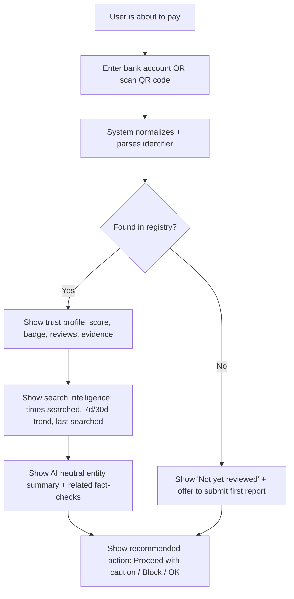
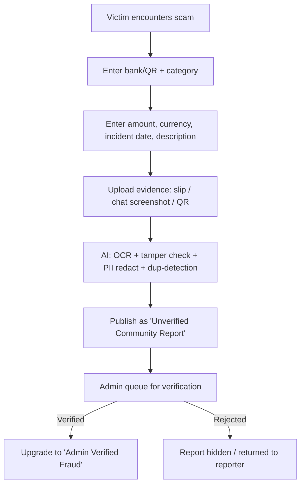
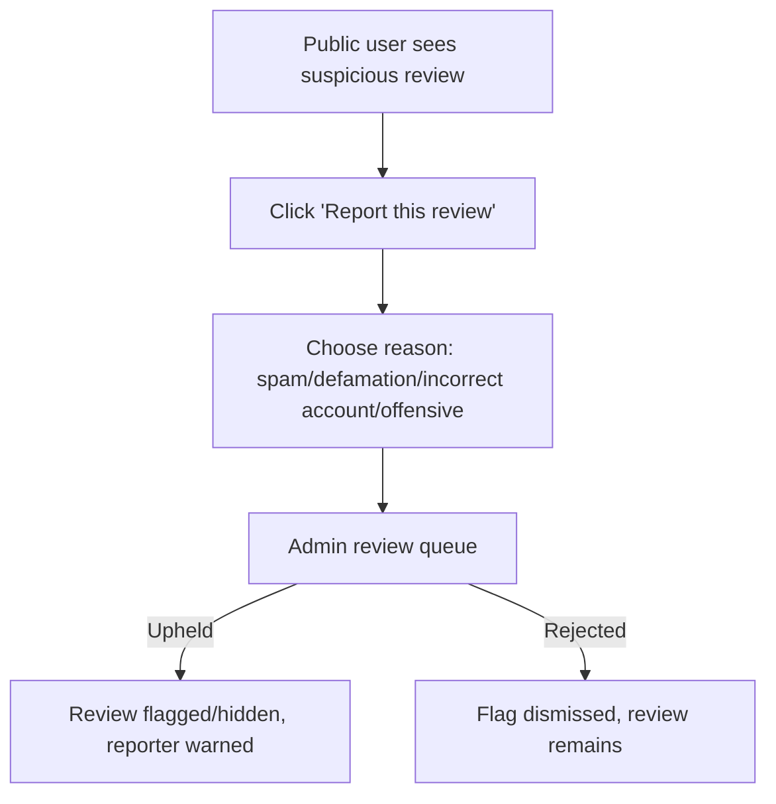
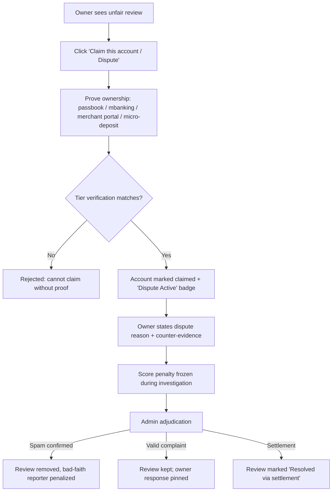

# 01 — Product Blueprint: TrustPay SEA

**Product**: BFSI — Intelligent Risk, Fraud & Financial Experiences
**Doc Version**: 1.0 · **Status**: Approved for planning
**Target Region**: Southeast Asia (Indonesia, Malaysia, Thailand, Singapore, Vietnam, Philippines)

---

## 1. Executive Summary

TrustPay SEA is a **community-driven payment-risk and reputation registry** — the **Truecaller + Google Reviews** of Southeast Asian digital payments. Users check a bank account number or scan a QR code *before* sending money. Victims submit structured fraud reports with optional image evidence. The community reviews, upvotes, and flags reports. A legitimate account owner can dispute bad reviews — but only after **proving ownership** and providing a **reason**, which protects legitimate businesses while preventing scammer takedowns.

The platform combines:

- **Crowdsourced intelligence** (like Truecaller) — anyone can add a report.
- **Verified reputation** (like Google Reviews) — community upvotes, flags, and admin moderation.
- **AI-assisted forensics** — slip OCR, tamper detection, duplicate detection, review-bomb detection.
- **A fair, auditable dispute mechanism** — owners can remove spam reviews with proof, admins adjudicate.

The long-term vision elevates TrustPay SEA into **national infrastructure**: federated sync with government fraud registries — starting with **Indonesia's cekrekening.id** — plus analogous platforms from other SEA countries (PDRM Semak Mule / NSRC in Malaysia, SPF Anti-Scam Command in Singapore, MDES AOC in Thailand, NCSC in Vietnam, BSP IACAT in the Philippines), and a sub-50ms pre-transfer screening API for banks, e-wallets, and payment gateways. **SEA is the primary target market now; integration with official and trusted local platforms/tools is a core requirement, not an afterthought.**

---

## 2. Problem Context — The SEA Payment Scam Landscape

### 2.1 The Instant Payments Explosion

Southeast Asia has one of the world's fastest-growing instant payment ecosystems:

| Country | Instant Transfer | QR Scheme | Prominent Players |
|---------|-----------------|-----------|-------------------|
| Indonesia | BI-FAST | QRIS | BCA, BRI, Mandiri, GoPay, OVO, DANA |
| Malaysia | DuitNow Transfer | DuitNow QR | Maybank, CIMB, GrabPay, TNG eWallet |
| Thailand | PromptPay | PromptPay QR | Kasikorn, SCB, BBL, TrueMoney |
| Singapore | PayNow | SGQR | DBS, OCBC, UOB, Grab, PayLah |
| Vietnam | Napas 247 | VietQR | Vietcombank, MB Bank, MoMo, ZaloPay |
| Philippines | InstaPay | QR Ph | GCash, Maya, BDO, BPI |

### 2.2 The Scam Triad

1. **Irrevocable transfers.** Once money moves via QRIS/BI-FAST/PromptPay, it is practically impossible to reverse. There is no consumer chargeback.
2. **Proliferation of money mules.** Fraudsters buy dormant bank accounts or generate dynamic merchant QR codes to collect illicit funds, making the fraudster anonymous.
3. **SME review-bombing vulnerability.** A legitimate freelancer or MSME can be destroyed by a handful of malicious reviews, extortion attempts, or competitor smear campaigns — and currently has *zero* defense.

### 2.3 The Trust Gap

When a buyer sees an Instagram shop or marketplace seller, they have **no way to check whether a given bank account or QR code has been linked to fraud**. Information is scattered across private scam-reporting Facebook groups, slow government portals, and word-of-mouth.

TrustPay SEA fills this gap with an open, searchable, community-maintained registry.

---

## 3. Product Vision & Positioning

> **Vision**: *No one in Southeast Asia should lose money because they couldn't check who they were paying.*

**Positioning statement**: TrustPay SEA is the public fraud-intelligence and reputation layer for SEA payments — a single place to look up a payment destination before you pay, and a fair system to defend against unfair reviews.

### 3.1 Core Concepts

| Concept | Analogy | TrustPay SEA implementation |
|---------|---------|------------------------------|
| Payment entity lookup | Truecaller caller ID | Look up a bank account / scan a QR, get a trust profile |
| Community reviews | Google Reviews | Star/severity ratings, narrative, evidence gallery, helpful votes |
| Report invalid review | Google "report" button | Public users flag spam/defamation → admin moderation |
| Claim & remove review | Google Business owner response | Owner proves ownership + gives reason → admin adjudicates |
| Verified badge | Truecaller "verified" | Admin-verified fraud / verified legitimate business |

### 3.2 What We Are NOT

- ❌ Not a "hit list" labeling people as criminals.
- ❌ Not a replacement for police or government reporting (we *integrate* with them).
- ❌ Not used for lending decisions (no credit-scoring claims).
- ❌ Not anonymous defamation of businesses (balanced by owner-dispute rights + risk-neutral language).

---

## 4. User Personas

### Persona 1 — The Payer (Victim / Pre-Payment Checker)
- **Goal**: Avoid being scammed; verify the recipient before transferring money.
- **Scenario**: Sees a too-good-to-be-true deal on Instagram/TikTok. Scans the seller's QRIS or enters the bank account → sees a trust score, fraud reports, and history.

### Persona 2 — The Victim Reporter
- **Goal**: Warn others, get the account blacklisted, obtain evidence for police.
- **Behavior**: Submits a report with account/QR, category, amount, description, and screenshot evidence.

### Persona 3 — The Legitimate Account Owner (MSME, Freelancer, Business)
- **Goal**: Protect reputation against spam/extortion; claim ownership; respond to reviews.
- **Behavior**: Claims their account, submits proof of ownership + reason to remove bad reviews, gets a "verified owner" badge.

### Persona 4 — The Admin / Fraud Analyst
- **Goal**: Verify reports, adjudicate disputes, maintain registry integrity.
- **Behavior**: Reviews AI-assessed evidence, approves/rejects/removes reports, resolves ownership disputes, reviews review-flags.

### Persona 5 — The Consumer Moderator (community)
- **Goal**: Keep quality high by flagging invalid reviews and upvoting helpful ones.
- **Behavior**: Upvotes "helped me" reviews; reports spam/defamation.

### Persona 6 — The Enterprise / Government Partner (later phase)
- **Goal**: Integrate screening into banking apps; sync fraud lists with government.
- **Behavior**: Calls the B2B screening API before transfers; feeds/consumes blacklist data.

---

## 5. System Workflows (End-to-End)

### 5.1 Lookup / Check Flow (The Truecaller Moment)



### 5.2 Report Submission Flow



### 5.3 Review Flagging Flow (People report invalid reviews)



### 5.4 Owner Claim & Dispute Flow (The Anti-Smear Shield)



### 5.5 Anti-Smear Logic Essential

The owner **cannot** simply remove reviews — they must:
1. **Prove they are the actual owner** (ownership proof, not just "I am the owner").
2. **Provide a reason/category** for why the review should be removed.
3. Optionally provide **counter-evidence**.
4. Have the dispute **adjudicated** (admin decision) before removal, with the score freeze protecting the owner's reputation *during* the process.

This prevents both:
- **Review-bombing** (owners get an immediate safe-harbor freeze so spam can't tank their score).
- **Scammer takedowns** (scammers can't just remove valid fraud reports without proof).

---

## 6. Detailed Feature Specification

### 6.1 Payment Identity Resolver

**Epic**: Users must be able to reference any payment destination unambiguously.

| Feature | Description | Priority |
|---------|-------------|----------|
| Bank account normalization | Strip formatting, map bank codes, build canonical key | P0 |
| Bank directory | Bank code/BIC mapping for ID, MY, TH, SG, VN, PH | P0 |
| EMVCo QR parser | Parse QRIS/DuitNow/PromptPay/SGQR/VietQR TLV → merchant name, city, NMID, amount | P0 |
| QR scan from image | Upload image or camera scan → decode QR → parse | P0 |
| Wallet identifiers | E-wallet IDs (GoPay/OVO/DANA/TNG/GCash) | P1 |
| Phone-number identifiers | PromptPay/PayNow tied to phone numbers | P1 |

### 6.2 Reports & Reviews

**Epic**: Community-submitted fraud reports with evidence and community moderation.

| Feature | Description | Priority |
|---------|-------------|----------|
| Report submission | Entity + category + severity + amount + date + description | P0 |
| Evidence upload | Images/slips with AI PII redaction before public display | P0 |
| Review feed | List reports with severity bars, badges, narrative | P0 |
| Helpful votes | Upvote/downvote "this helped me" | P0 |
| **Report this review** | Flag invalid reviews (spam/defamation/incorrect account) | P0 |
| Reporter profile & trust | Reporter reputation weighting (repeat high-quality reporters) | P1 |
| Rural/broadcast mode | Notify subscribers when an entity they follow gets new reports | P2 |

### 6.3 Admin Verification Portal

**Epic**: Admins manually verify reports and resolve disputes.

| Feature | Description | Priority |
|---------|-------------|----------|
| Admin RBAC | roles: fraud analyst, senior analyst, superadmin | P0 |
| Moderation queue | Pending reports/claims/flags side-by-side evidence compare | P0 |
| AI-assist panel | Show OCR results, tamper signals, duplicate matches, risk score factors | P0 |
| Approve/Reject/Annotate | Set admin_verification_status with notes | P0 |
| Enforcement actions | Hide/remove reports, warn/ban reporters, penalize bad faith | P0 |
| Audit log | Full immutable trail of every moderation action | P0 |

### 6.4 Owner Claim & Dispute

**Epic**: Legitimate owners claim entities and dispute unfair reviews.

| Feature | Description | Priority |
|---------|-------------|----------|
| Claim entity | Submit ownership proof (passbook/mbanking/merchant portal/micro-deposit OTP) | P0 |
| Dispute submission | Reason category + justification + counter-evidence | P0 |
| Safe-harbor freeze | Score penalty frozen at ≤45 while dispute active; public badge | P0 |
| Owner response | Verified owner can pin public response under reviews | P1 |
| Settlement flow | Merchant proves refund → review marked resolved | P1 |
| Dispute history | Public is transparent that a dispute happened and its outcome | P0 |

### 6.5 Trust / Risk Score & Badges

| Feature | Description | Priority |
|---------|-------------|----------|
| Explainable score 0–100 | Bayesian composite with factor breakdown | P0 |
| Trust badge | Green (verified clean) / Amber (unverified) / Red (fraud) | P0 |
| Score breakdown UI | Show why: gov blacklist, verified reports, community reports, dispute freeze, merchant KYC | P0 |
| Anti-brigading detection | Sliding-window velocity spikes → score dampening + admin priority | P0 |
| Government blacklist badge | `GOV_VERIFIED_FRAUD` gold badge when matched with gov list | P1 |

### 6.6 Platform Foundation

| Feature | Description | Priority |
|---------|-------------|----------|
| AuthN/AuthZ | Email/OTP signup, social login; role-based access | P0 |
| Search | Exact canonical lookup + QR scan; masked results | P0 |
| PII protection | Account numbers stored hashed, masked display | P0 |
| Notifications | In-app/email: dispute status, reply, review flag outcomes | P1 |
| Content moderation | Profanity/abuse filter, auto-PII-redaction | P1 |

### 6.7 SEA Government & Ecosystem Integration (Future Pillar — requires permissions)

> **⚠️ Important scope note**: Direct integration with official government platforms (cekrekening.id, PDRM Semak Mule, etc.) **requires formal permissions, MoUs, and approval processes that take a long time**. Therefore:
> 1. **Gov-sync is explicitly a POST-MVP / Phase 5+ item** in this plan.
> 2. **What we build NOW is the open Public API** — a well-documented, versioned REST/OpenAPI surface that *other platforms, including government portals later, can integrate with*. We build the standard first; permissions come later.
> 3. The public API means our data is machine-readable and shareable, so the eventual gov integration is a *connector on top of an API we already own* — not a rewrite.

TrustPay SEA is designed to eventually become a **bidirectional bridge** between crowdsourced citizen intelligence and official/trusted SEA platforms. The product targets Indonesia first and expands across SEA, but the *enabling foundation* — the **open Public API** — is delivered early.

#### 6.7.1 Open Public API (NOW — in MVP plan)

| Feature | Description | Priority |
|---------|-------------|----------|
| `GET /api/v1/screen/account` | High-speed lookup of a bank/e-wallet entity → risk score, blacklist status, reports count | P0 |
| `POST /api/v1/screen/qr` | Submit raw EMVCo payload or QR image → parsed metadata + risk assessment | P0 |
| `POST /api/v1/reports/external` | Verified partners (communities, gateways) submit fraud reports programmatically | P1 |
| OpenAPI 3.0 spec + sandbox | Swagger docs, API keys, sandbox/test environment, rate limits | P0 |
| Webhook alerts (optional) | Push notifications on risk changes for partners | P2 |

The Public API is required so that:
- Communities / NGOs / spreadsheets can pull structured risk data.
- Payment gateways can programmatically flag fraud.
- **Future** government tools can be *connected* to us without us needing to scrape or wait for their APIs.

#### 6.7.2 Official Government Anti-Scam Platforms per Country (POST-MVP)

| Country | Platform / Tool | Role in TrustPay SEA (future) |
|---------|----------------|---------------------|
| 🇮🇩 Indonesia | **cekrekening.id** (Kominfo/Kemkomdigi + OJK) | **Primary pilot.** Inbound: ingest verified blacklisted accounts & e-wallets → `GOV_VERIFIED_FRAUD` badge (risk 100). Outbound: package verified evidence bundles (≥3 valid reports + police STPLP) for referral |
| 🇮🇩 Indonesia | **Patroli Siber (cyber police)** & OJK Anti-Scam Center (IASC) | Inbound: sanctioned account alerts; Outbound: case handoff |
| 🇲🇾 Malaysia | **PDRM Semak Mule** & **NSRC (National Scam Response Centre)** | Inbound: sync CCID mule database (accounts & numbers under investigation); Outbound: referrals |
| 🇸🇬 Singapore | **SPF Anti-Scam Command** & **ABS Project COSMIC** | Inbound: cross-bank scam/mule signals; Outbound: reporting interface |
| 🇹🇭 Thailand | **MDES AOC 1441** | Inbound: frozen/flagged account feed; Outbound: evidence dossiers |
| 🇻🇳 Vietnam | **NCSC / 5656** national scam hotline | Inbound: sanctioned account/merchant signal; Outbound: referral |
| 🇵🇭 Philippines | **BSP IACAT** & e-commerce MoU signatories (GCash/Maya) | Inbound: mule account reports; Outbound: referrals |

#### 6.7.3 Ecosystem "Tools" & Trusted Platforms (non-government, via Public API)

- **Bank & e-wallet internal risk teams** — feedback loop on verified fraud.
- **Scam-reporting communities** (sebarkan.info, Facebook groups like "Info Penipuan", NSRC social channels) — seed data and outreach.
- **Payment gateways** (Midtrans, Xendit, dLocal, PayMongo) — programmatic report ingestion via partner API.
- **Reconciliation & screening vendors** — complement, not overlap (we standardize the community layer).

#### 6.7.4 Integration Design Principles

1. **Public API first, gov connectors later**: we standardize our own data contract now; official integrations are adapters built on *our* API, activated when permissions are granted.
2. **Adapter interface**: every future country/portal is a `GovAdapter` behind one common interface — add a new country = write one adapter.
3. **Bi-directional (eventually)**: inbound (consume official blacklists) *and* outbound (referral of verified community evidence).
4. **GOV badge as sovereign risk signal**: `is_gov_blacklisted=true` immediately forces risk score to 100 regardless of dispute state (implemented via the Public API contract now, wired to real feeds later).

### 6.8 Search & Entity Intelligence (Lookup Profile)

When a user searches an account or scans a QR, the profile is far richer than Truecaller. Beyond the trust score, users see **search popularity and report history**:

| Field | Description | Source |
|-------|-------------|--------|
| Has ever been reported | Yes/No badge + total report count | `fraud_reports` |
| **Times searched (all-time)** | Aggregate count ("searched ~1.2k times") | `entity_search_stats` |
| **Searches (7d / 30d)** | Popularity trend + delta indicator | `entity_search_stats` |
| **Last searched** | "Searched 3 hours ago" recency signal | `entity_search_stats` |
| First reported | Date the entity entered the registry | `fraud_reports` |
| Report velocity | New reports last 7/30 days + mini sparkline | `fraud_reports` |
| Total loss reported | Sum + currency (masked to nearest k) | `fraud_reports` |
| Top categories | Most common complaint types | `fraud_reports` |
| Helpful votes | Aggregate "helped me" upvotes | `fraud_reports`/vote table |
| Verified owner? | Badge if ownership proven | `owner_disputes` |
| Dispute status | "Dispute active — investigation in progress" | `owner_disputes` |
| Gov blacklist | `GOV_VERIFIED_FRAUD` badge (mock in MVP) | `GovAdapter` |
| Merchant metadata (QR) | Name, city, MCC, NMID | `payment_entities` |
| Similar entities (later) | Linked accounts/QRs in suspected syndicate | graph module |

**Privacy design note**: search counts are **aggregate, rounded, anonymized statistics** — never individualized ("*your* searches"). We only surface them above a minimum threshold so a single person's behavior cannot be fingerprinted. This keeps the lookup profile useful while remaining privacy-compliant.

### 6.9 AI Search & Fact-Check Augmentation

**AI Search integration (Gemini-powered):**
- **Neutral AI entity summary**: aggregates structured report data into an objective paragraph — *"This QRIS merchant has received 4 community reports since Mar 2026, primarily describing unfulfilled orders. No admin-verified fraud. 1 active dispute."* Strictly derived from internal data (no free-form hallucination).
- **Search disambiguation**: help users confirm they matched the correct account/QR before paying ("You scanned BCA 883-****-831 — exact match").
- **RAG Q&A (later)**: "Ask about this account" — natural-language answers grounded only in that entity's reports.

**Google Fact Check Tools / AI Search augmentation (optional):**
- When a report is classified (e.g., `FAKE_JOB`), query the **Google Fact Check Tools API** (shared fact-checks) for related verifiable claims → display *"Related public fact-checks"* links alongside the entity profile.
- Additionally, when a user researches a scam type, surface reputable fact-checked explainers to boost literacy.
- **Safeguards**: external links are clearly labeled as references, never as verdicts on the specific entity; AI summaries are derived only from internal structured data.

---

## 7. Trust Score Definition (0–100)

### 7.1 Score bands

| Band | Label | Meaning |
|------|-------|---------|
| 0–20 | Safe / Verified Clean | Owner verified, no confirmed fraud |
| 21–50 | Caution / Dispute Active | Low activity or active dispute (score frozen at ≤45) |
| 51–79 | High Risk | Multiple consistent community reports with evidence |
| 80–100 | Critical Fraud | Admin-verified fraud / government blacklist |

### 7.2 Explainability requirement

Every score must display its **factor breakdown**:
```
Risk Score: 72 / 100  HIGH RISK
  + 35 → 1 admin-verified fraud report
  + 20 → community reports (3 reports, severity 4,5,4)
  + 17 → upvote weight (5 helpful marks)
  = 72   (dampened 0.85× during anomaly spike; no dispute active)
```

---

## 8. Monetization & Growth (Future — not needed for hackathon MVP)

| Model | Description | Suitability |
|-------|-------------|-------------|
| B2B screening API | SaaS for banks/e-wallets/payment gateways; per-100k calls pricing | post-MVP |
| Freemium business profile | Verified merchants pay for verified badge + analytics + response tools | post-MVP |
| Marketplace/feeds | "Reported scammers spreadsheet exporter" for NGOs/communities | data-only |
| Public-interest grant / GovTech MoU | Government data contribution funding | post-MVP |

**MVP goal is not revenue** — it is **trust density**: a critical mass of reports + verified owners + admin integrity so that the registry is actually useful in daily payments.

---

## 9. Success Metrics

### Hackathon / MVP Metrics
- ✅ Can look up a bank account and a QRIS code end-to-end.
- ✅ Lookup shows: ever reported, all-time search count, 7d/30d search trend, last-searched recency signal.
- ✅ Can submit a report with image; AI extracts amount/date/tamper signal.
- ✅ Can upvote and **flag** a review; flag reaches admin queue.
- ✅ Owner can **claim + dispute** a review with proof; score freeze engages; admin resolves.
- ✅ 0–100 explainable score renders with factor breakdown.
- ✅ AI neutral entity summary + (if API key available) related fact-check links.

### Product Traction Metrics (post-MVP)
- **MAU**: monthly active lookups
- **Report-to-verify TAT**: median hours from submission to admin decision
- **Flag accuracy**: % of review-flags upheld by admins
- **Dispute TAT**: median time to dispute resolution
- **Trust density**: # accounts with ≥1 verified report per 10k active users
- **Integrity rate**: % of walkaway disputes (proof mismatches) rejected

---

## 10. Risks & Mitigations

| Risk | Likelihood | Mitigation |
|------|-----------|------------|
| Defamation lawsuits (UU ITE etc.) | High | Risk-neutral language, PII masking, owner-dispute safe harbor, audit logs |
| Review-bombing of legit businesses | High | Velocity detection, score freeze under dispute, admin priority queue |
| Scammers gaming the dispute system | Medium | Proof-of-ownership tiers + admin adjudication; removal not automatic |
| Duplicate/fake evidence | Medium | pHash de-duplication, tamper detection, admin review of low-confidence AI |
| Low report volume at launch | High | Seed data approach, focus on 1 market (Indonesia) first, community outreach |
| Data scraping of registry | Medium | Salted hashed account numbers, no bulk exports publicly; search counts aggregated + rounded above threshold so individual behavior can't be reconstructed |
| AI summary hallucination | Low | AI entity summary strictly template-derived from structured fields; fact-check links clearly labeled as external references |
| Government API availability | Low (later) | Mock adapters, adapter interface, documented MoU requirements |

---

## 11. Go-To-Market (MVP Focus)

1. **Single-market focus**: Launch Indonesia (QRIS) — largest TAM, QRIS ubiquitous.
2. **Grassroots communities**: Partner with scam-reporting Facebook groups, LINE/WA communities; provide "check before you pay" as a habit.
3. **Merchant-advocacy angle**: Give MSMEs a way to fight review bombs → earns organic media/public attention.
4. **Demonstration via BFSI hackathon theme**: highlight B2B API + gov-sync direction in demo to show scale.

---

## 12. Foundational Operating Principles

1. **Fairness by design**: every actor gets a voice (reporter, reviewer, owner, admin).
2. **Explainability**: no black-box scoring; everything is auditable.
3. **Privacy-first**: minimal PII on public surface; evidence redacted by default.
4. **Neutral language**: report facts, not verdicts.
5. **Human-in-the-loop**: AI assists, admins decide on high-stakes actions.

---

*Next: [02 — Technical Design Document](02-technical-design.md)*