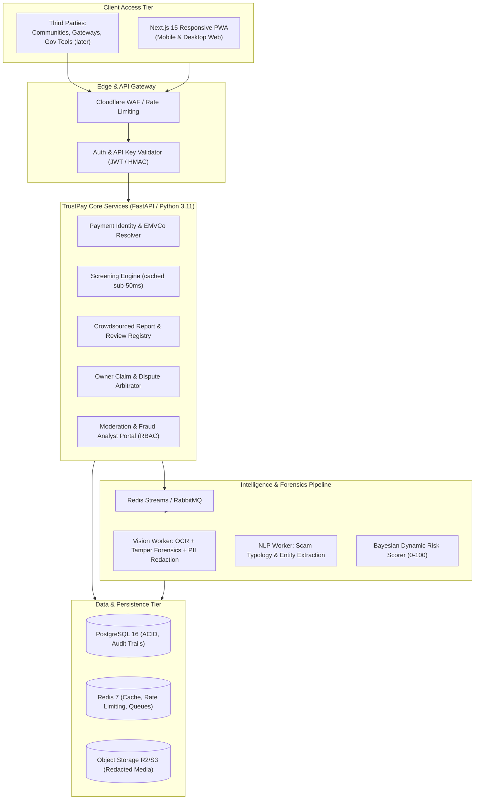
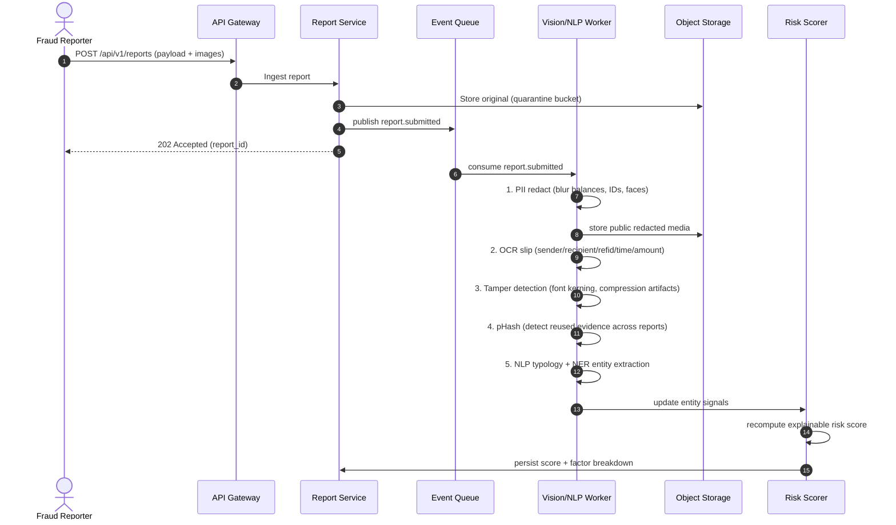
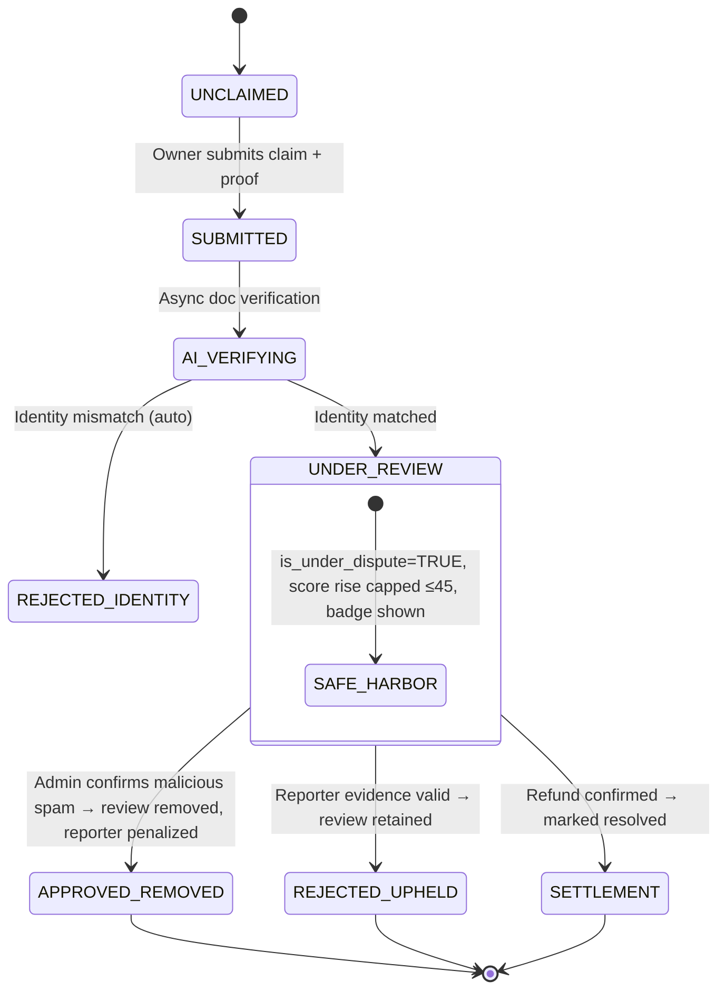
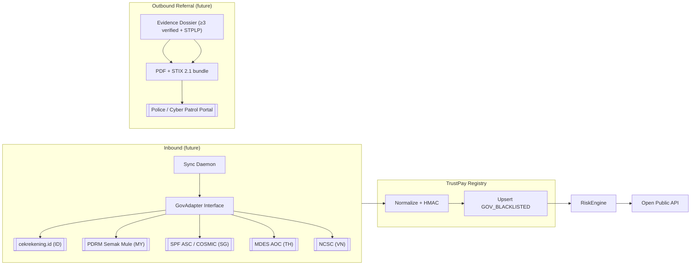

# 02 — Technical Design Document (TDD): TrustPay SEA
## Intelligent Risk, Fraud & Financial Experiences Platform

**Doc Version**: 1.0 · **Status**: Approved for planning
**Target Region**: Southeast Asia (Indonesia, Malaysia, Thailand, Singapore, Vietnam, Philippines)
**Classification**: Engineering & Architecture Specification

---

## 1. System Architecture Overview

TrustPay SEA is an **event-driven modular monolith** with asynchronous AI pipelines and a first-class **Open Public API**. The design prioritizes: (a) sub-second community lookups, (b) asynchronous AI forensics so report submission never blocks, (c) explainable scoring, (d) an open data contract that government platforms can later plug into.



### Tech Stack Recommendation

| Layer | Choice | Rationale |
|-------|--------|-----------|
| Frontend | Next.js 15 (App Router) + Tailwind + `html5-qrcode` | Camera QR scanning, mobile-first, PWA |
| Backend | FastAPI (Python 3.11) | Native OpenCV/Pillow/GenAI ecosystem, typed OpenAPI generation |
| DB | PostgreSQL 16 | Relational integrity, audit trails, JSONB |
| Cache/Queue | Redis 7 | Instant lookup cache + event stream queue (single infra) |
| Storage | Cloudflare R2 / AWS S3 | Signed uploads, thumbnails |
| AI | Google Gemini 1.5 Flash (vision) + OpenCV | Multimodal forensics + tamper detection |
| ORM | SQLAlchemy 2.0 / Alembic | Mature, migration support |

---

## 2. Payment Identity Resolver

### 2.1 Bank Account Normalization Algorithm

Prevents duplicate records from formatting variation (`014-123456-7` vs `014 1234567`):

```
Input: country, scheme, entity_type, institution, account_raw

1. sanitize = strip [^0-9A-Za-z] from account_raw (preserve significant leading zeros per institution rules)
2. institution_code = canonical code/BIC (014=BCA, 002=BRI, 022=CIMB, MAYBANK, KASIKORN, DBS, ...)
3. canonical_key = country + ":" + scheme + ":" + entity_type + ":" + institution_code + ":" + sanitize
4. account_hash   = HMAC_SHA256(canonical_key, kms_key)   // key held in KMS/HSM, per-row hash_version (ADR-013)
5. masked = first3 + "-****-" + last3
```

- **entity_type + scheme in the key (H11 fix)** prevents a phone alias colliding with a bank account of the same digits, or a QR NMID colliding with a raw account.
- Lookups are **exact-match on hash** — no substring/ILIKE enumeration.
- Country + institution + scheme prevents cross-border and cross-scheme collision.

### 2.2 EMVCo QR TLV Parser Specification

Supports QRIS (ID), DuitNow (MY), PromptPay (TH), PayNow/SGQR (SG), VietQR (VN), QR Ph (PH).

| Tag | Field | Notes |
|-----|-------|-------|
| 00 | Payload Format Indicator | `01` |
| 01 | Point of Initiation | `11` static, `12` dynamic |
| 26–51 | Merchant Account Info | Subtag 00 = reverse domain (`ID.CO.QRIS.WWW`, `MY.DUITNOW.WWW`, `TH.OR.PROMPTPAY`); subtag 01 = National Merchant ID / account |
| 52 | MCC | 4-digit ISO 18245 |
| 53 | Currency | ISO 4217 (360 IDR, 458 MYR, 764 THB, 702 SGD, 704 VND, 608 PHP) |
| 54 | Amount | present in dynamic QR |
| 58 | Country | ISO 3166-1 alpha-2 |
| 59 | Merchant Name | ≤25 chars |
| 60 | Merchant City | ≤15 chars |
| 63 | CRC16 checksum | validate before trust |

**Flow**: QR image → (client decode `jsQR`/`html5-qrcode` for instant preview) → server re-parses TLV + validates CRC + extracts NMID → canonical entity key = `scheme:NMID` (QRIS) or `scheme:merchant_account` (DuitNow/PromptPay).

> **ADR-001**: hybrid client/server parsing. See ADR doc.

---

## 3. Data Model (PostgreSQL)

> Full normalized schema. Migration files live in the implementation plan's backend phase.

### 3.1 Users & Auth

```sql
CREATE TABLE users (
    id UUID PRIMARY KEY DEFAULT gen_random_uuid(),
    email VARCHAR(255) UNIQUE NOT NULL,
    phone VARCHAR(30),
    phone_verified BOOLEAN DEFAULT FALSE,
    display_name VARCHAR(120),
    password_hash TEXT,              -- argon2id
    role VARCHAR(20) NOT NULL DEFAULT 'USER', -- USER | ANALYST | SENIOR_ANALYST | SUPERADMIN
    identity_trust INT DEFAULT 10,   -- identity-graph trust (ADR-014): NEW accounts start LOW, not 50
    -- trust builds: +30 phone-verified, +15 email+age>=30d, +20 two reports upheld by admins
    reputation_score INT DEFAULT 50, -- public reporter trust rank (Trust Rank Ladder, for display)
    status VARCHAR(20) DEFAULT 'ACTIVE',     -- ACTIVE | WARNED | SUSPENDED | BANNED
    created_at TIMESTAMPTZ DEFAULT NOW()
);
```

> **Identity-graph trust (A-C1/ADR-014)**: `identity_trust` is the *security* weight used by anti-brigading — it starts at **10** (not 50) so sock-puppet networks remain detectable. `reputation_score` is the *public/display* rank ladder (starts 50 neutral). Phone-verified users get the "Verified Reporter" badge and their reports weigh higher.

### 3.2 Payment Entities (accounts / QR / wallets)

```sql
CREATE TABLE payment_entities (
    id UUID PRIMARY KEY DEFAULT gen_random_uuid(),
    entity_type VARCHAR(20) NOT NULL,       -- BANK_ACCOUNT | QR_CODE | E_WALLET | PHONE_ALIAS
    scheme VARCHAR(30),                     -- QRIS | DUITNOW | PROMPTPAY | PAYNOW | VIETQR | QRPH | BANK
    country_code VARCHAR(2) NOT NULL,
    institution_code VARCHAR(50),
    account_hash VARCHAR(64) UNIQUE NOT NULL,  -- KMS-keyed HMAC-SHA256 canonical key (index, never reverse)
    hash_version INT DEFAULT 1,                -- algorithm version for key rotation (ADR-013)
    account_masked VARCHAR(50) NOT NULL,       -- '883-****-831'
    merchant_name VARCHAR(150),
    merchant_city VARCHAR(100),
    mcc VARCHAR(4),                            -- ISO 18245 merchant category code (clean QR extraction)
    nmid VARCHAR(100),
    emvco_payload TEXT,
    risk_score INT DEFAULT 15,                -- 0-100
    verification_status VARCHAR(30) DEFAULT 'UNVERIFIED',
    -- UNVERIFIED | COMMUNITY_REPORTED | ADMIN_CONFIRMED_FRAUD | VERIFIED_LEGIT_OWNER | GOV_BLACKLISTED
    is_gov_blacklisted BOOLEAN DEFAULT FALSE,     -- derived flag; TRUE forces risk_score=100 (ADR-006)
    is_owner_verified BOOLEAN DEFAULT FALSE,      -- derived flag; ownership proven via claim tiers
    total_reports INT DEFAULT 0,
    total_loss_reported NUMERIC(18,2) DEFAULT 0,
    is_under_dispute BOOLEAN DEFAULT FALSE,
    dispute_hold_score_cap INT DEFAULT 45,
    owner_claimed_by UUID REFERENCES users(id),
    owner_response TEXT,                     -- verified owner's pinned public response
    created_at TIMESTAMPTZ DEFAULT NOW(),
    updated_at TIMESTAMPTZ DEFAULT NOW()
);
-- Indexes: (account_hash) unique; (country_code, scheme); (verification_status)
```

### 3.2b Entity Search Statistics (popularity & recency signals)

Aggregate, privacy-safe counters of how often an entity is looked up. Used for `timessearched`, `searches_7d`, `searches_30d`, `last_searched` on profiles.

```sql
CREATE TABLE entity_search_stats (
    payment_entity_id UUID PRIMARY KEY REFERENCES payment_entities(id) ON DELETE CASCADE,
    total_searches BIGINT DEFAULT 0,          -- all-time lookups (rounded for display)
    searches_7d  INT DEFAULT 0,               -- last 7 days window
    searches_30d INT DEFAULT 0,               -- last 30 days window
    last_searched_at TIMESTAMPTZ,
    last_7d_window_started_at DATE,           -- rolling window bookkeeping
    last_30d_window_started_at DATE,
    updated_at TIMESTAMPTZ DEFAULT NOW()
);
```

- **Privacy rule**: totals are stored exactly but **displayed rounded** (e.g., "~1.2k") and only shown once `total_searches >= MIN_DISPLAY_THRESHOLD` (e.g., 5) so single-user behavior is never fingerprinted.
- **Window strategy**: simple, acceptable for MVP — daily cron rolls window counters using event buckets (`search_events_daily` table: `entity_id, day, count`). No per-user tracking is stored.

```sql
CREATE TABLE search_events_daily (
    payment_entity_id UUID NOT NULL REFERENCES payment_entities(id) ON DELETE CASCADE,
    day DATE NOT NULL,
    search_count INT DEFAULT 0,
    PRIMARY KEY (payment_entity_id, day)
);
```

### 3.3 Reports & Reviews

```sql
CREATE TABLE fraud_reports (
    id UUID PRIMARY KEY DEFAULT gen_random_uuid(),
    payment_entity_id UUID NOT NULL REFERENCES payment_entities(id) ON DELETE CASCADE,
    reporter_user_id UUID REFERENCES users(id),
    category VARCHAR(50) NOT NULL,     -- ONE canonical taxonomy (see §4.3): ONLINE_SHOP_GHOSTING | FAKE_JOB | INVESTMENT_PIG_BUTCHERING | PHISHING_PRETEXTING | IMPERSONATION | UNAUTHORIZED_LENDING_PINJOL | NO_DELIVERY_GOODS | EVENT_TICKET_FRAUD | OTHER
    severity INT NOT NULL CHECK (severity BETWEEN 1 AND 5),
    currency VARCHAR(3) DEFAULT 'IDR',
    loss_amount NUMERIC(18,2),
    incident_date DATE,
    description TEXT NOT NULL,
    processing_status VARCHAR(30) DEFAULT 'PROCESSING', -- PROCESSING|PUBLISHED|FAILED (async pipeline state)
    ai_risk_score INT,                      -- AI credibility 0-100
    ai_forensic_notes JSONB,                -- OCR extracted, tamper flags
    admin_verification_status VARCHAR(30) DEFAULT 'PENDING', -- PENDING|APPROVED|REJECTED
    status VARCHAR(30) DEFAULT 'ACTIVE',    -- ACTIVE|HIDDEN|REMOVED_BY_DISPUTE|REMOVED_BY_MODERATOR|RESOLVED_BY_SETTLEMENT
    police_report_number VARCHAR(64),       -- STPLP / police report ref (nullable; filled on referral)
    is_legal_hold BOOLEAN DEFAULT FALSE,    -- freeze deletion when law-enforcement case active
    upvotes_count INT DEFAULT 0,
    downvotes_count INT DEFAULT 0,
    flags_count INT DEFAULT 0,
    created_at TIMESTAMPTZ DEFAULT NOW()
);
```

**Canonical data-model note**: `fraud_reports.category` is the **single source of truth** for the category enum. The NLP classifier (§4.3) and the public API (screen responses, `primary_category`) MUST map to this same vocabulary. No other taxonomy is introduced.

### 3.4 Evidences

```sql
CREATE TABLE report_evidences (
    id UUID PRIMARY KEY DEFAULT gen_random_uuid(),
    report_id UUID NOT NULL REFERENCES fraud_reports(id) ON DELETE CASCADE,
    media_url TEXT NOT NULL,                 -- public redacted URL
    original_quarantine_url TEXT,           -- restricted-access original
    media_type VARCHAR(20) NOT NULL,        -- TRANSFER_SLIP | CHAT_LOG | QR_IMAGE | OTHER
    is_blurred_pii BOOLEAN DEFAULT TRUE,
    image_hash VARCHAR(64),                 -- pHash for duplicated evidence detection
    ocr_extracted_text TEXT,
    ai_tampering_detected BOOLEAN DEFAULT FALSE,
    tampering_signals JSONB,
    created_at TIMESTAMPTZ DEFAULT NOW()
);
```

### 3.5 Owner Claims & Disputes

```sql
CREATE TABLE owner_disputes (
    id UUID PRIMARY KEY DEFAULT gen_random_uuid(),
    payment_entity_id UUID NOT NULL REFERENCES payment_entities(id) ON DELETE CASCADE,
    target_report_id UUID REFERENCES fraud_reports(id),   -- NULL = dispute whole entity status
    claimed_by_user_id UUID REFERENCES users(id),
    claim_stage VARCHAR(30) DEFAULT 'UNCLAIMED',  -- UNCLAIMED|SUBMITTED|AI_VERIFYING|UNDER_REVIEW|APPROVED_REMOVED|REJECTED_IDENTITY|REJECTED_UPHELD|SETTLEMENT
    owner_proof_type VARCHAR(50) NOT NULL,   -- BANK_PASSBOOK | MBANKING_SCREENSHOT | MERCHANT_PORTAL_NMID | MICRO_DEPOSIT_OTP
    owner_proof_document_url TEXT NOT NULL,
    -- Two-step flow (ADR-004): ownership proof is validated BEFORE dispute fields are required.
    dispute_reason VARCHAR(50),              -- NULL until owner proves identity: SPAM_REVIEW_BOMB|RESOLVED_REFUNDED|IDENTITY_THEFT|FALSE_CLAIM|OTHER
    justification_statement TEXT,            -- NULL until owner proves identity
    counter_evidence_urls JSONB,
    status VARCHAR(30) DEFAULT 'SUBMITTED',  -- SUBMITTED|AI_VERIFYING|UNDER_REVIEW|APPROVED_REMOVED|REJECTED_IDENTITY|REJECTED_UPHELD|SETTLEMENT
    dispute_badge_public BOOLEAN DEFAULT TRUE,
    reviewed_by_admin_id UUID REFERENCES users(id),
    resolution_notes TEXT,
    resolved_at TIMESTAMPTZ,
    created_at TIMESTAMPTZ DEFAULT NOW()
);
```

> **State-machine alignment (C4 fix)**: `claim_stage` reuses the same enum as `status`; both include `REJECTED_IDENTITY`, `REJECTED_UPHELD`, and `SETTLEMENT`. The public start state is `UNCLAIMED` (no dispute row exists yet — claim row created on first submission).

### 3.6 Review Flags (Community flagging of invalid reviews)

```sql
CREATE TABLE review_flags (
    id UUID PRIMARY KEY DEFAULT gen_random_uuid(),
    report_id UUID NOT NULL REFERENCES fraud_reports(id) ON DELETE CASCADE,
    flagged_by_user_id UUID REFERENCES users(id),
    reason VARCHAR(50) NOT NULL,             -- DEFAMATION_SPAM | INCORRECT_ACCOUNT | OFFENSIVE_CONTENT | OTHER
    details TEXT,
    status VARCHAR(30) DEFAULT 'PENDING',    -- PENDING|UPHELD|DISMISSED
    reviewed_by_admin_id UUID REFERENCES users(id),
    created_at TIMESTAMPTZ DEFAULT NOW(),
    UNIQUE (report_id, flagged_by_user_id, reason)   -- no duplicate flags per user
);
```

### 3.7 Moderation & Audit Log

```sql
CREATE TABLE audit_logs (
    id BIGSERIAL PRIMARY KEY,
    actor_user_id UUID,
    action VARCHAR(50) NOT NULL,   -- REPORT_APPROVED | REPORT_REJECTED | REVIEW_HIDDEN | DISPUTE_RESOLVED | USER_BANNED ...
    subject_type VARCHAR(30),
    subject_id UUID,
    before JSONB,
    after JSONB,
    note TEXT,
    prev_hash VARCHAR(64),         -- SHA256 of previous row (hash chain) → tamper-evident
    row_hash VARCHAR(64) NOT NULL, -- SHA256 of this row's fields + prev_hash
    created_at TIMESTAMPTZ DEFAULT NOW()
);
```

> **Tamper-evidence (C-A4)**: `audit_logs` is a hash-chained append-only table. Any UPDATE/DELETE breaks the chain; a nightly reconciler verifies `row_hash == H(fields + prev_hash)` and alerts on mismatch. High-stakes actions additionally require dual-control approval (see Security §9).

### 3.8 Report Votes (helpful/downvote table — C10 fix)

```sql
CREATE TABLE report_votes (
    report_id UUID NOT NULL REFERENCES fraud_reports(id) ON DELETE CASCADE,
    voter_user_id UUID NOT NULL REFERENCES users(id),
    vote SMALLINT NOT NULL CHECK (vote IN (-1, 1)),   -- -1 downvote, +1 upvote
    created_at TIMESTAMPTZ DEFAULT NOW(),
    PRIMARY KEY (report_id, voter_user_id)            -- one vote per user per report → no double-voting
);
```

`fraud_reports.upvotes_count` / `downvotes_count` are **denormalized cache** of this table (recomputed on insert/delete). Vote-weighting by reporter trust lives in the risk scorer (§5.3).

---

## 4. AI & Forensics Pipeline

### 4.1 Async Processing Sequence



**Guarantees**
- Report submission returns `202` immediately (user never waits on AI).
- Public evidence is **always the redacted copy**; originals stay in encrypted quarantine.
- pHash prevents the same screenshot being used to flood multiple reports.

### 4.2 Tamper Detection Signals (MVP subset)

1. Font-kerning anomalies around amount/refid regions.
2. Inconsistent JPEG compression quality across regions of a slip.
3. Mismatched bank logo asset.
4. Excessive pixel-artifacts around numbers (resized text).

Output: `ai_tampering_detected: bool` + `tampering_signals: {...}` (not used to auto-reject, only to inform admin and raise forensics weight).

### 4.3 NLP Scam Typology

Model: Gemini 1.5 Flash zero-shot + guided prompt.

Maps free text to the **single canonical taxonomy** (same vocabulary as `fraud_reports.category`, matching DB enum + public API):

`ONLINE_SHOP_GHOSTING | FAKE_JOB | INVESTMENT_PIG_BUTCHERING | PHISHING_PRETEXTING | IMPERSONATION | UNAUTHORIZED_LENDING_PINJOL | NO_DELIVERY_GOODS | EVENT_TICKET_FRAUD | OTHER`

> **Security note (A-C3)**: all report/OCR/metadata text is **untrusted input, never instructions**. The classifier runs with JSON-schema output and a grounding check; adversarial prompt-injection tests are a blocking CI gate (§12, ADR-013). Extracted NER is masked before public display:
> - phone numbers, telegram/id usernames, URLs, amounts, dates.

---

## 5. Explainable Risk Scorer

### 5.1 Formula

```
R = clamp( R_base
          + Δ_gov            // +100 if gov blacklisted (is_gov_blacklisted=true)
          + 35 × N_admin_verified
          + Σ community(10×severity_i + 2×min(10,upvotes_i)) × dampen_factor
          + Δ_forensics      // +20 if tampering detected
          - Δ_merchant_kyc   // -20 verified legitimate owner w/ business KYC
          - Δ_resolution     // -15 resolved/settled complaints
        , 0, 100)
```

- `R_base = 15` for all new entities; `dampen_factor = 0.45` when anti-brigading spike detected.
- **Dispute freeze (revised — prevents gaming)**: when `is_under_dispute = TRUE` AND NOT `is_gov_blacklisted`, the score is **capped at ≤ 45 for NEW/recent hints only**. The effective score is `effective_score = max(score_without_recent_unverified, 45_floor_from_prior_verified_state)`. In plain terms: the freeze **only prevents the score from rising** from new reports; it must **never reduce an already high/verified score** (a controlled mule account cannot drag 88 down to 45 by claiming "dispute").
- **Gov override**: if `GOV_BLACKLISTED`, score = 100 regardless of dispute (appeal path still exists for gov-listed entities, see §12).

### 5.2 Anti-Brigading / Review-Bomb Detector

Using a sliding window **over a human-identity graph**, not raw row counts:

```
identity = device_fingerprint ∪ (IP/ASN ∩ phone_verification) ∪ payment_instrument
velocity = count(reports in last 3h from DISTINCT identities, weighted by identity trust)

identity_trust = base 10 for unverified-new-account users (NOT 50)
               + 30 if phone-verified
               + 15 if email-verified & account_age >= 30 days
               + 20 if two previous reports upheld by admins

if velocity >= 3 AND avg(identity_trust) < 45:
    flag ANOMALY_SPIKE_DETECTED
    dampen_factor = 0.45
    route entity to admin priority queue
    notify existing owner if claimed
```

Also enforced:
- **Per-entity hourly cap**: no more than N (e.g., 5) reports total from unverified identities per entity per hour; over-cap → `PROCESSING` reports enter gravity queue, not score.
- **Long-window z-score**: EWMA over 7-day baseline; spike = > 3σ from mean, catches attacker spacing submissions >3h apart.
- **Evidence-grade rule**: only `admin_verified` or high-confidence `ai_tampering_detected=false` evidence contributes weights to the *band*, not just raw count.

### 5.3 Factor Breakdown (public transparency)

Every score response includes:
```json
{
  "score": 72,
  "factors": [
    {"label": "gov_blacklist",   "weight": 0},
    {"label": "admin_verified",  "weight": 35},
    {"label": "community",       "weight": 37, "dampened": true}
  ],
  "dispute_hold": false
}
```

> **Explainability + anti-gaming (A-H4)**: exact weights are shown ONLY to the verified owner and admins for appeal. The public API returns **rounded factor labels** ("community reports: moderate") plus the score, so an attacker cannot exactly reverse-engineer the threshold. The verified owner can see exact weights via authenticated appeal.

---

## 6. Owner Claim & Dispute State Machine



> **Freeze semantics (A-C2 fix)**: During `UNDER_REVIEW`, the system **caps only score *increases*** from new/unverified reports (≤45 floor for existing verified state). It never reduces an already high score (e.g., an 88 gov/admin-flagged entity stays visible as HIGH RISK with a "Dispute active" label — the badge informs, it does not mask).

### Ownership Proof Tiers

| Tier | Method | How Verified |
|------|--------|--------------|
| T1 | Bank passbook / mbanking profile screenshot | AI OCR name+account matches entity record (proves control; does NOT grant removal of admin-verified fraud) |
| T1b | Merchant portal NMID screenshot (Midtrans/Xendit/BCA Merchant) | AI OCR NMID matches QR payload NMID (control-level proof) |
| T2 | Micro-deposit challenge (Rp 127 + OTP in note) | User enters OTP → cryptographically proves account control |
| T3 | Business license (NIB/SSM/ACRA) + bank-confirmed merchant KYC | OCR license + name match, senior-analyst review (strictest; needed for freeze of admin-verified/gov records) |

**Control vs. legitimacy (A-C2 fix)**: T1/T2 prove *control* of an account — a mule operator controls a mule account, so these do **not** by themselves grant dispute rights over admin-verified or gov-listed fraud records. Only **T3** (business KYC) or **human-verified ownership** (analyst behind `is_owner_verified`) can challenge those. For all tiers: removal of a review is **never automatic** — it requires admin adjudication; the owner's benefit during dispute is the capped-rise freeze + public badge, not instant removal.

---

## 7. Open Public API (MVP deliverable)

Standard: **OpenAPI 3.0**, API keys via header `X-API-Key`, rate-limited per key, sandbox + prod endpoints.

### 7.1 `GET /api/v1/screen/account`

Prefix-screen a bank account / e-wallet before transfer.

```
GET /api/v1/screen/account?country=ID&bank=014&account=8830192831
```

Response `200` (target < 45ms from Redis cache):
```json
{
  "status": "success",
  "data": {
    "query": {"country": "ID", "institution": "BCA", "account_masked": "883-****-831"},
    "risk_assessment": {
      "risk_score": 100,
      "risk_level": "CRITICAL_FRAUD",
      "is_gov_blacklisted": true,
      "gov_source": "cekrekening.id (mock)",
      "is_under_dispute": false,
      "is_verified_legit": false
    },
    "community_signals": {
      "total_reports": 4,
      "admin_verified_reports": 2,
      "total_loss_reported": 7450000,
      "currency": "IDR",
      "primary_category": "EVENT_TICKET_FRAUD"
    },
    "search_intelligence": {
      "total_searches": "~1.2k",
      "searches_7d": 48,
      "searches_30d": 312,
      "last_searched_at": "2026-10-12T09:14:00Z"
    },
    "recommended_action": "BLOCK_OR_WARN_USER",
    "warning_message": "Warning: This recipient is registered in an official government fraud blacklist (mock)."
  }
}
```

### 7.2 `POST /api/v1/screen/qr`

Accepts raw EMVCo string **or** base64 QR image (`qr_image` optional; when absent `qr_payload` required).

```
POST /api/v1/screen/qr
Content-Type: application/json
{
  "qr_payload": "<raw EMVCo string>",
  "qr_image": "<optional base64 PNG/JPEG>"
}
```

Response `200` (same shape as §7.1 — search intelligence + community signals included consistently):
```json
{
  "status": "success",
  "data": {
    "query": {"masked_method": "QRIS code CV ELEKTRONIK JAYA MURAH"},
    "qr_metadata": {
      "scheme": "QRIS (Indonesia)",
      "merchant_name": "CV ELEKTRONIK JAYA MURAH",
      "merchant_city": "JAKARTA",
      "national_merchant_id": "936009140021948201",
      "point_of_initiation": "STATIC"
    },
    "risk_assessment": {
      "risk_score": 88,
      "risk_level": "CRITICAL_FRAUD",
      "is_gov_blacklisted": false,
      "is_under_dispute": false,
      "is_verified_legit": false
    },
    "community_signals": {
      "total_reports": 3,
      "admin_verified_reports": 1,
      "total_loss_reported": 8200000,
      "currency": "IDR",
      "primary_category": "EVENT_TICKET_FRAUD"
    },
    "search_intelligence": {
      "total_searches": "~860",
      "searches_7d": 21,
      "searches_30d": 140,
      "last_searched_at": "2026-10-11T22:03:00Z"
    },
    "recommended_action": "BLOCK_OR_WARN_USER",
    "warning_message": "High-risk QR: this merchant has 3 unresolved community fraud reports."
  }
}
```

> **risk_level mapping (C9 fix)** — shared enum across all endpoints: `0-20 → LOW_RISK`, `21-50 → CAUTION`, `51-79 → HIGH_RISK`, `80-100 → CRITICAL_FRAUD`. Example above uses `CRITICAL_FRAUD` (88) consistent with the blueprint bands.

### 7.3 `POST /api/v1/reports/external` (partner ingestion)

Verified partners may submit structured reports programmatically. Requires partner API key with `reports:write` scope. Fields mirrored from web form.

### 7.4 Rate Limits & Sandbox

| Tier | Limit | Notes |
|------|-------|-------|
| Public anon | 60 req/min/IP | for web app |
| Free API key | 1,000 req/day | sandbox enabled |
| Partner key | contract | gateway partners, gateways (Midtrans/Xendit etc.) |

### 7.5 Search Intelligence & AI Augmentation

**Response shape** — every `screen` response also carries search-popularity and enrichment data once thresholds are met:

```json
{
  "search_intelligence": {
    "total_searches": "~1.2k",
    "searches_7d": 48,
    "searches_30d": 312,
    "last_searched_at": "2026-10-12T09:14:00Z",
    "first_reported_at": "2026-03-02T00:00:00Z",
    "report_velocity_7d": 1,
    "report_velocity_30d": 5
  },
  "ai_summary": "This QRIS merchant has received 4 community reports since Mar 2026, primarily describing unfulfilled orders. No admin-verified fraud. 1 active dispute.",
  "related_fact_checks": [
    {
      "title": "Claims of 'instant 300% robocash' investment accounts circulating on social media",
      "publisher": "CekFakta (verif)",
      "url": "https://...",
      "rating": "false"
    }
  ]
}
```

#### 7.5.1 AI Entity Summary (Gemini)

- Template-driven prompt over **structured fields only** (report counts, categories, verified status, dispute status, first/last report dates).
- Governed by system instructions: *derive from given JSON only, never invent facts, keep neutral wording*.
- Cached per entity with invalidation on report/dispute changes (avoids cost & drift).

#### 7.5.2 Google Fact Check Tools / AI Search Augmentation

- **Google Fact Check Tools API** (`factchecktools.googleapis.com/v1alpha1/claims:search`) — official public API returning fact-checked claims from a network of publishers.
- Used to enrich a report/entity profile with **related public fact-checks** (matched by scam category + keywords + merchant name).
- **Not** used as a verdict: links are surfaced as `related_fact_checks[]` references, clearly external.
- **Mock-first**: if no API key, return empty `related_fact_checks` and show a graceful "no public fact-checks found" state. Integration is behind an optional `FACTCHECK_API_KEY` env var.

#### 7.5.3 Anti-Scraping Protection for Search Stats

- Rounding + minimum display threshold for `total_searches`.
- Search counters update asynchronously (background write, not blocking response).
- Rate-limit anonymous lookups; bots get throttled before they can harvest.

---

## 8. B2G / Gov Integration Connectors (Post-MVP · post-permissions)

> **Scope note**: `GovAdapter` interface is defined NOW; real national portals are connected when permissions (MoUs, API access) are granted. During MVP we ship a **mock adapter** with fixtures.



Adapter interface template:

```python
class GovAdapter(ABC):
    source = "cekrekening.id"  # or semak-mule, spf-asc, mdes-aoc, ncsc
    @abstractmethod
    async def fetch_blacklist_diff(self, since): ...
    @abstractmethod
    async def submit_referral(self, dossier): ...
    @abstractmethod
    async def healthcheck(self): ...
```

---

## 9. Security, Privacy & Anti-Defamation Shield

### 9.1 PII Masking & Storage

1. **PII masking**:
   - Account numbers stored as **KMS-keyed `HMAC_SHA256(canonical_key)`** + `hash_version` (ADR-013), never cleartext, never exposed in API/autocomplete.
   - Public evidence images are **always AI-redacted** copies.
2. **At-rest encryption**: AES-256/GCM for evidence quarantine; DSK envelope encryption for owner-KYC docs; DB credentials via secret manager/KMS (never `.env` in prod).
3. **Upload security (H2)**:
   - Validate **magic bytes** (not extension) before accepting; reject non-image MIME.
   - **Re-encode** images through a normalizer (strips EXIF/GPS, kills polyglots/SVG).
   - Max dimensions/pixel count enforced **before** decode (blocks decompression bombs); worker runs with CPU/memory/time limits.
   - AV scan (ClamAV) on quarantined originals.
   - Public media served from a **separate cookieless domain** with `Content-Disposition: attachment`; private buckets + short-lived signed URLs; no object listing.
   - **Fail-closed redaction**: if PII redaction fails, the evidence is NEVER published (report stuck in `PROCESSING` → `FAILED`, surfaced to admin).

### 9.2 AuthN & Sessions

- argon2id password hashing; JWT short-lived access + refresh with **rotation + reuse detection**; RS256/ES256 pinned algorithm (reject `none`/alg-confusion); audience/issuer validation; server-side revoke/jti denylist.
- **Phishing-resistant MFA (WebAuthn/passkeys)** **mandatory** for ANALYST/SENIOR_ANALYST/SUPERADMIN; step-up auth for sensitive actions.
- Tokens in `HttpOnly; Secure; SameSite` cookies (not localStorage); CSRF protection; shortest sensible TTLs.

### 9.3 Human-in-the-Loop (AI-Assisted, Never Auto-Deciding)

- AI computes credibility scores, OCR/tamper signals, duplicates, typology; **admin makes the final call** for anything that alters published content/score/ownership (ADR-009).
- **Dual-control / four-eyes** required for destructive or trust-altering actions: report removal, account ban, gov-override flip, bulk ops.
- **Tamper-evident audit**: `audit_logs` is hash-chained (prev_hash) append-only; nightly reconciler alerts on chain gaps; high-stakes actions logged + confirmed twice. (ADR-013)

### 9.4 Anti-Insider & Abuse Controls

- **Identity-graph anti-brigading** — device/IP/phone clustering, not raw user counts; per-entity hourly cap; EWMA z-score over 7-day baseline; identity fingerprints stored **hashed** with TTL (ADR-014).
- **Vote abuse**: one vote per user per report (`report_votes` PK); reputation/age-weighted votes; vote-velocity anomaly detection; unverified accounts limited.
- **Flag abuse**: per-user flag rate limits; reputation weighting; bad-faith flaggers penalized; **never auto-hide on flag count** (admin action required).
- **Partner reports (M7)**: HMAC-signed requests (+timestamp+nonce replay protection), per-partner quotas + anomaly review, partner reports quarantined to a distinct trust class (never auto-elevate).
- **Concurrency/idempotency**: every POST accepts an `Idempotency-Key`; duplicate submission keys rejected.

### 9.5 Network, Edge & API Guard

- Cloudflare WAF + bot management; trust only CF-attached client IP; geo/ASN throttling (SEA focus); CAPTCHA on signup/report after-risk.
- **SSRF (H3)**: never fetch user-supplied URLs server-side; where required, egress proxy + DNS-rebinding-safe resolver + private/loopback/link-local block + scheme/host allow-list + no automatic redirects.
- **Rate limiting**: token-bucket per key+IP+device fingerprint; distinct-account-query anomaly detection on the screen API (lookup-oracle/doxxing protection); no bulk export endpoint; canary records per partner key.
- **API keys**: stored **hashed** with prefix + last-4 (Stripe-style); scopes (`screen:read`, `reports:write`, `webhooks:manage`); mandatory rotation/expiry/revoke; sandbox keys distinct; **never** embed keys in the PWA (BFF/server proxy for first-party traffic).
- **Webhooks (outbound)**: HMAC-signed payloads with per-subscription secrets + timestamps; callback allow-list + private-range block; retries with backoff; replay-resistant IDs.
- **Security headers**: CSP, HSTS, `X-Content-Type-Options: nosniff`, `frame-ancestors DENY`, Referrer-Policy, Permissions-Policy.
- **Redis hardening**: AUTH + TLS + private subnet (never public), signed cache entries (fail-closed to DB, not fail-open to "safe"), TTL discipline.
- **QR/TLV parser limits**: max payload length + nesting depth (DoS guard).

### 9.6 AI Boundary & Data-Flow Controls

- **Prompt-injection proof (ADR-013)**: all report/OCR/merchant text = untrusted data; JSON-schema structured output; summary templated server-side from validated fields; grounding check rejects claimed facts absent from input; adversarial injection test suite is a **blocking CI gate**.
- **Strip PII before any third-party LLM call**: raw evidence/balance/IDs never sent to Google; redact-then-send.
- **Cross-border**: region-pin storage (SEA/ID region-buckets + Gemini/Vertex in-region preferred); DPAs + transfer-impact assessment; documented lawful basis + DPIA. (H7)
- **Responsible disclosure**: `security.txt`, private vulnerability channel with triage SLA.

### 9.7 Operations & Resilience

- **Backups/DR**: Postgres PITR + multi-AZ, encrypted immutable (Object Lock) backups, documented RPO/RTO, **restore drills**; Redis persistence + failover; append-only audit sink independent of primary DB.
- **Queues**: retry w/ backoff, dead-letter queue, poison-message handling, idempotent consumers, worker observability (queue depth, latency, failure rate).
- **Secrets**: central secret manager/KMS; gitleaks/trufflehog in CI/pre-commit; `.env.example` committed, `.env*` ignored.
- **Supply chain**: pinned/locked deps, SCA (pip-audit, npm audit, Dependabot) as CI gate, SBOM, signed images.
- **Log hygiene**: structured logging with allow-listed fields; no PII/tokens/OCR/account numbers in logs; sanitize control characters (log-injection).

### 9.8 Privacy Law, Consent & Compliance

- **Consent UX (M1)**: explicit consent before publishing evidence (checkbox + link to Terms/Privacy in report flow); separate consent for owner-KYC doc retention.
- **DSAR/erasure (H8)**: self-serve portal — export/correct/delete own reports & data; erasure semantics defined (delete reports/evidence, tombstone entity hash, remove from search); DSARs logged + SLA'd.
- **Retention (H9)**: per-data-class schedule (originals auto-purged N days post-verification; redacted-only kept); legal-hold flag on `fraud_reports.is_legal_hold`; documented subpoena/legal-request handling.
- **Elderly/minors**: age policy + parental-consent path; optionally a high-contrast "elderly mode".
- **Gov-referral consent**: outbound dossiers contain only what's authorized; explicit lawful-basis statement for sending victim evidence to authorities.

### 9.9 Defamation Shield

- Neutral risk language (`"Unfulfilled Transaction Incident Report"`, never `"Penipu"`); risk levels objective; owner dispute rights + rise-only freeze + public badge.
- **Correction/appeal (M16)**: appeal & correction path for wrongly flagged entities, contested AI summaries, stale gov matches.
- **Conflict-of-interest / recusal** policy for admin-analyst dual roles; transparent moderation standards + versioned community guidelines.

---

## 10. Operations & Non-Functional Requirements (missing-requirements close-out)

### 10.1 i18n & Localization
- PWA must be **multi-language**: `id-ID`, `ms-MY`, `th-TH`, `vi-VN`, `fil-PH`, `zh-SG`/`en-SG`. Strings in a catalog (i18next/lingui); date/number/currency locale-aware. MVP ships `en` + `id` at minimum; the rest post-MVP.

### 10.2 Currency & Loss Aggregation
- Reports carry their own `currency`; `total_loss_reported` is kept **per-currency** as JSON map (`{ "IDR": 7450000, "MYR": 3200 }`) for aggregated display.
- Public API returns `total_loss_by_currency: {}` plus a **converted display value** using a pinned FX snapshot (updated daily) for the primary locale currency. No silent cross-currency arithmetic in the score.

### 10.3 Entity Lifecycle & Anti-Poisoning
- Entities are created **on-demand on first report** (not on anonymous lookup); anonymous lookups never insert rows (prevents scraping/poisoning).
- Stray/duplicate entities (same canonical hash) are prevented by the unique `account_hash`; reconcile job flags near-duplicate masked names for admin review.
- Bad-input UX taxonomy: specific error codes for unsupported bank, malformed length, bad CRC, corrupt QR image (ADR-002 consequence).

### 10.4 Notifications
- `user_notifications` table (user, type, entity_id, payload, read_at); email/PWA-push providers via async job.
- Events: dispute status, flag outcome, new report on watched entity, score band crossing, gov-list match, brigade alert to owner.
- Anti-spam: per-user notification rate cap; signed links; allow-list redirect targets.

### 10.5 Police-Record & Legal-Referral Capture
- `fraud_reports.police_report_number` (STPLP) + `is_legal_hold` flag; referral workflow packages only verified + legal-hold-marked reports.
- Report→verify→refer TAT analytics computed from `audit_logs` timestamps (join submission→decision events).

### 10.6 Analytics & Observability
- Event schema for: search, screen, submit, publish, flag, dispute, resolve, decision. Tracked with no PII.
- Dashboards for the blueprint's success metrics (MAU, TAT, flag accuracy, trust density, integrity rate).
- Request tracing (correlation ids) API-wide; error surfaces generic (no stack traces).

### 10.7 Env & Deployment Docs
- `README` Getting-Started, `.env.example` (all vars incl. `FACTCHECK_API_KEY`, KMS key ids, Redis URI), `docker compose` profiles, and a deploy doc (private MVP = Railway/Fly.io + R2/S3; prod = Kubernetes-ready).

---

## 11. SLOs & Performance Targets (MVP)

| Concern | Target |
|---------|--------|
| Account screen lookup (cached) | < 45ms (search-stats count increment is async, never on hot path) |
| QR screen lookup | < 250ms |
| Report submission API | < 1s (aggregate), return 202 in < 150ms |
| Search autocomplete | < 200ms |
| Public API availability | 99.5% (sandbox) |
| Avg admin decision TAT | < 24h for reports/flags; < 48h for disputes (goal, process-dependent) |
| AI entity summary generation | < 1s (async, cached per entity) |
| Evidence redaction (fail-closed) | 100% published media is redacted or unpublished |
| Audit chain integrity | nightly reconciler reports 0 gaps |

---

## 12. Security & Hardening Appendix (audit-conformed)

The following controls were added from the planning security review. Each maps to a MUST-FIX/HIGH finding:

| # | Control | Finding | Status |
|---|---------|---------|--------|
| S1 | Identity-graph anti-brigading (S5.2) | A-C1 | Design ✓ (Phase 6) |
| S2 | Rise-only dispute freeze | A-C2 | Design ✓ (Phase 5) |
| S3 | Untrusted-input AI boundary + grounding + injection suite | A-C3 | Design ✓ (Phase 3/7) |
| S4 | MFA + dual-control + hash-chained audit | A-C4 | Design ✓ (Phase 0/7) |
| S5 | KMS/HSM key + `hash_version` + envelope encryption | A-C5 | Design ✓ (Phase 1/7) |
| S6 | AI cost/submission quotas + cheap pre-filtering | H1 | Design ✓ (Phase 2) |
| S7 | Upload security (magic bytes, re-encode, AV, cookieless domain) | H2 | Design ✓ (Phase 2) |
| S8 | SSRF-safe URL handling | H3 | Design ✓ (Phase 2/5) |
| S9 | Rounded-factor public scoring, exact only to owner | H4 | Design ✓ (Phase 6) |
| S10 | Lookup-oracle anti-doxxing (distinct-account anomaly, no bulk export) | H5 | Design ✓ (Phase 7) |
| S11 | HSM-stored hashed API keys + scopes + rotation, BFF for web | H6 | Design ✓ (Phase 7) |
| S12 | Region-pinned storage/AI + DPA + TIAs | H7 | Design ✓ (setup) |
| S13 | DSAR/erasure + retention + legal-hold | H8/H9 | Design ✓ (Phase 2/7) |
| S14 | Anti-phishing (SPF/DKIM/DMARC, in-app claim, no OTP-by-link) | H10 | Design ✓ (Phase 5) |
| S15 | Canonical-key collision guards (incl. entity_type+scheme, leading zeros) | H11 | Design ✓ (Phase 1) |
| S16 | Homoglyph/lookalike-name + QR-change detection | H12 | Design ✓ (Phase 1/3) |
| S17 | Evidence-confidence-weighted scoring | H13 | Design ✓ (Phase 6) |
| S18 | Webhook signature + redirect allow-list + notif rate caps | M8 | Design ✓ (Phase 7) |

---

*Next: [03 — Architecture Decision Records](03-architecture-decision-records.md)*