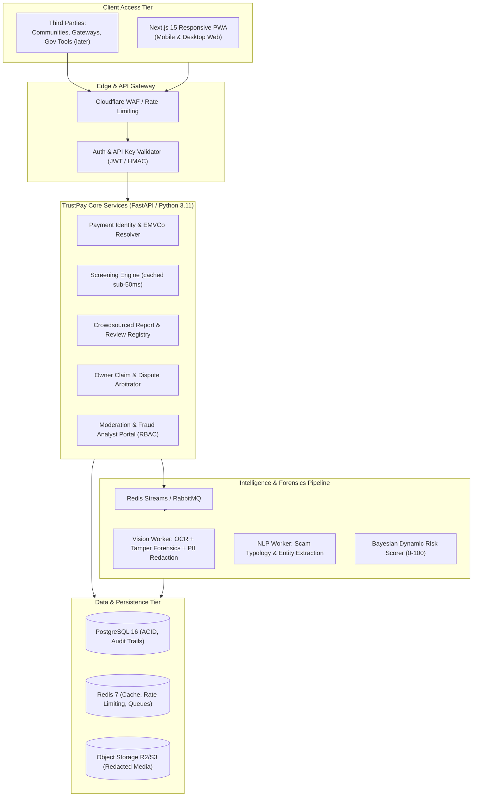
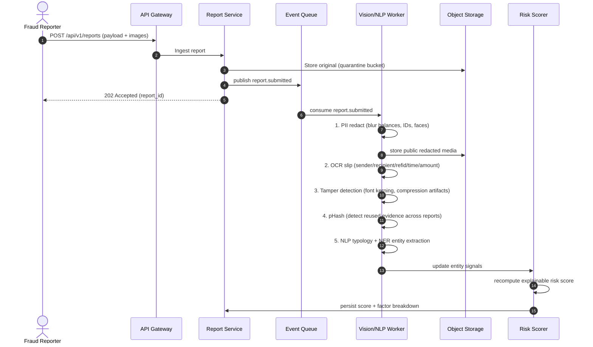
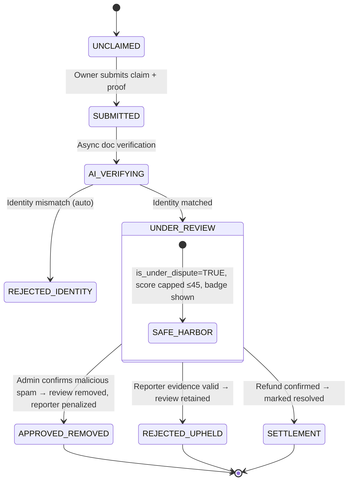
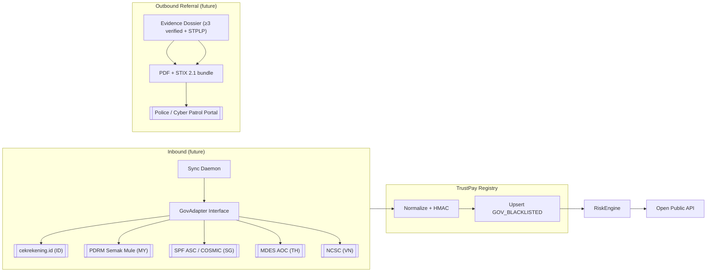

# 02 — Technical Design Document (TDD): TrustPay SEA
## Intelligent Risk, Fraud & Financial Experiences Platform

**Doc Version**: 1.0 · **Status**: Approved for planning
**Target Region**: Southeast Asia (Indonesia, Malaysia, Thailand, Singapore, Vietnam, Philippines)
**Classification**: Engineering & Architecture Specification

---

## 1. System Architecture Overview

TrustPay SEA is an **event-driven modular monolith** with asynchronous AI pipelines and a first-class **Open Public API**. The design prioritizes: (a) sub-second community lookups, (b) asynchronous AI forensics so report submission never blocks, (c) explainable scoring, (d) an open data contract that government platforms can later plug into.



### Tech Stack Recommendation

| Layer | Choice | Rationale |
|-------|--------|-----------|
| Frontend | Next.js 15 (App Router) + Tailwind + `html5-qrcode` | Camera QR scanning, mobile-first, PWA |
| Backend | FastAPI (Python 3.11) | Native OpenCV/Pillow/GenAI ecosystem, typed OpenAPI generation |
| DB | PostgreSQL 16 | Relational integrity, audit trails, JSONB |
| Cache/Queue | Redis 7 | Instant lookup cache + event stream queue (single infra) |
| Storage | Cloudflare R2 / AWS S3 | Signed uploads, thumbnails |
| AI | Google Gemini 1.5 Flash (vision) + OpenCV | Multimodal forensics + tamper detection |
| ORM | SQLAlchemy 2.0 / Alembic | Mature, migration support |

---

## 2. Payment Identity Resolver

### 2.1 Bank Account Normalization Algorithm

Prevents duplicate records from formatting variation (`014-123456-7` vs `014 1234567`):

```
Input: country, institution, account_raw

1. sanitize = strip [^0-9A-Za-z] from account_raw
2. institution_code = canonical code/BIC (014=BCA, 002=BRI, 022=CIMB, MAYBANK, KASIKORN, DBS, ...)
3. canonical_key = country + ":" + institution_code + ":" + sanitize
4. account_hash   = HMAC_SHA256(canonical_key, server_salt)   // index key, never cleartext
5. masked = first3 + "-****-" + last3
```

- Lookups are **exact-match on hash** — no substring/ILIKE enumeration.
- Country + institution prevents cross-border collision.

### 2.2 EMVCo QR TLV Parser Specification

Supports QRIS (ID), DuitNow (MY), PromptPay (TH), PayNow/SGQR (SG), VietQR (VN), QR Ph (PH).

| Tag | Field | Notes |
|-----|-------|-------|
| 00 | Payload Format Indicator | `01` |
| 01 | Point of Initiation | `11` static, `12` dynamic |
| 26–51 | Merchant Account Info | Subtag 00 = reverse domain (`ID.CO.QRIS.WWW`, `MY.DUITNOW.WWW`, `TH.OR.PROMPTPAY`); subtag 01 = National Merchant ID / account |
| 52 | MCC | 4-digit ISO 18245 |
| 53 | Currency | ISO 4217 (360 IDR, 458 MYR, 764 THB, 702 SGD, 704 VND, 608 PHP) |
| 54 | Amount | present in dynamic QR |
| 58 | Country | ISO 3166-1 alpha-2 |
| 59 | Merchant Name | ≤25 chars |
| 60 | Merchant City | ≤15 chars |
| 63 | CRC16 checksum | validate before trust |

**Flow**: QR image → (client decode `jsQR`/`html5-qrcode` for instant preview) → server re-parses TLV + validates CRC + extracts NMID → canonical entity key = `scheme:NMID` (QRIS) or `scheme:merchant_account` (DuitNow/PromptPay).

> **ADR-001**: hybrid client/server parsing. See ADR doc.

---

## 3. Data Model (PostgreSQL)

> Full normalized schema. Migration files live in the implementation plan's backend phase.

### 3.1 Users & Auth

```sql
CREATE TABLE users (
    id UUID PRIMARY KEY DEFAULT gen_random_uuid(),
    email VARCHAR(255) UNIQUE NOT NULL,
    phone VARCHAR(30),
    display_name VARCHAR(120),
    password_hash TEXT,              -- argon2id
    role VARCHAR(20) NOT NULL DEFAULT 'USER', -- USER | ANALYST | SENIOR_ANALYST | SUPERADMIN
    reputation_score INT DEFAULT 50, -- reporter trust weight
    status VARCHAR(20) DEFAULT 'ACTIVE',     -- ACTIVE | WARNED | SUSPENDED | BANNED
    created_at TIMESTAMPTZ DEFAULT NOW()
);
```

### 3.2 Payment Entities (accounts / QR / wallets)

```sql
CREATE TABLE payment_entities (
    id UUID PRIMARY KEY DEFAULT gen_random_uuid(),
    entity_type VARCHAR(20) NOT NULL,       -- BANK_ACCOUNT | QR_CODE | E_WALLET | PHONE_ALIAS
    scheme VARCHAR(30),                     -- QRIS | DUITNOW | PROMPTPAY | PAYNOW | VIETQR | QRPH | BANK
    country_code VARCHAR(2) NOT NULL,
    institution_code VARCHAR(50),
    account_hash VARCHAR(64) UNIQUE NOT NULL,  -- HMAC_SHA256 canonical key (index, never reverse)
    account_masked VARCHAR(50) NOT NULL,       -- '883-****-831'
    merchant_name VARCHAR(150),
    merchant_city VARCHAR(100),
    nmid VARCHAR(100),
    emvco_payload TEXT,
    risk_score INT DEFAULT 15,                -- 0-100
    verification_status VARCHAR(30) DEFAULT 'UNVERIFIED',
    -- UNVERIFIED | COMMUNITY_REPORTED | ADMIN_CONFIRMED_FRAUD | VERIFIED_LEGIT_OWNER | GOV_BLACKLISTED
    total_reports INT DEFAULT 0,
    total_loss_reported NUMERIC(18,2) DEFAULT 0,
    is_under_dispute BOOLEAN DEFAULT FALSE,
    dispute_hold_score_cap INT DEFAULT 45,
    owner_claimed_by UUID REFERENCES users(id),
    created_at TIMESTAMPTZ DEFAULT NOW(),
    updated_at TIMESTAMPTZ DEFAULT NOW()
);
-- Indexes: (account_hash) unique; (country_code, scheme); (verification_status)
```

### 3.2b Entity Search Statistics (popularity & recency signals)

Aggregate, privacy-safe counters of how often an entity is looked up. Used for `timessearched`, `searches_7d`, `searches_30d`, `last_searched` on profiles.

```sql
CREATE TABLE entity_search_stats (
    payment_entity_id UUID PRIMARY KEY REFERENCES payment_entities(id) ON DELETE CASCADE,
    total_searches BIGINT DEFAULT 0,          -- all-time lookups (rounded for display)
    searches_7d  INT DEFAULT 0,               -- last 7 days window
    searches_30d INT DEFAULT 0,               -- last 30 days window
    last_searched_at TIMESTAMPTZ,
    last_7d_window_started_at DATE,           -- rolling window bookkeeping
    last_30d_window_started_at DATE,
    updated_at TIMESTAMPTZ DEFAULT NOW()
);
```

- **Privacy rule**: totals are stored exactly but **displayed rounded** (e.g., "~1.2k") and only shown once `total_searches >= MIN_DISPLAY_THRESHOLD` (e.g., 5) so single-user behavior is never fingerprinted.
- **Window strategy**: simple, acceptable for MVP — daily cron rolls window counters using event buckets (`search_events_daily` table: `entity_id, day, count`). No per-user tracking is stored.

```sql
CREATE TABLE search_events_daily (
    payment_entity_id UUID NOT NULL REFERENCES payment_entities(id) ON DELETE CASCADE,
    day DATE NOT NULL,
    search_count INT DEFAULT 0,
    PRIMARY KEY (payment_entity_id, day)
);
```

### 3.3 Reports & Reviews

```sql
CREATE TABLE fraud_reports (
    id UUID PRIMARY KEY DEFAULT gen_random_uuid(),
    payment_entity_id UUID NOT NULL REFERENCES payment_entities(id) ON DELETE CASCADE,
    reporter_user_id UUID REFERENCES users(id),
    category VARCHAR(50) NOT NULL,     -- ONLINE_SHOP | FAKE_JOB | INVESTMENT_SCAM | PHISHING | UNPAID_DELIVERY | IMPERSONATION | OTHER
    severity INT NOT NULL CHECK (severity BETWEEN 1 AND 5),
    currency VARCHAR(3) DEFAULT 'IDR',
    loss_amount NUMERIC(18,2),
    incident_date DATE,
    description TEXT NOT NULL,
    ai_risk_score INT,                      -- AI credibility 0-100
    ai_forensic_notes JSONB,                -- OCR extracted, tamper flags
    admin_verification_status VARCHAR(30) DEFAULT 'PENDING', -- PENDING|APPROVED|REJECTED
    status VARCHAR(30) DEFAULT 'ACTIVE',    -- ACTIVE|HIDDEN|REMOVED_BY_DISPUTE|REMOVED_BY_MODERATOR
    upvotes_count INT DEFAULT 0,
    downvotes_count INT DEFAULT 0,
    flags_count INT DEFAULT 0,
    created_at TIMESTAMPTZ DEFAULT NOW()
);
```

### 3.4 Evidences

```sql
CREATE TABLE report_evidences (
    id UUID PRIMARY KEY DEFAULT gen_random_uuid(),
    report_id UUID NOT NULL REFERENCES fraud_reports(id) ON DELETE CASCADE,
    media_url TEXT NOT NULL,                 -- public redacted URL
    original_quarantine_url TEXT,           -- restricted-access original
    media_type VARCHAR(20) NOT NULL,        -- TRANSFER_SLIP | CHAT_LOG | QR_IMAGE | OTHER
    is_blurred_pii BOOLEAN DEFAULT TRUE,
    image_hash VARCHAR(64),                 -- pHash for duplicated evidence detection
    ocr_extracted_text TEXT,
    ai_tampering_detected BOOLEAN DEFAULT FALSE,
    tampering_signals JSONB,
    created_at TIMESTAMPTZ DEFAULT NOW()
);
```

### 3.5 Owner Claims & Disputes

```sql
CREATE TABLE owner_disputes (
    id UUID PRIMARY KEY DEFAULT gen_random_uuid(),
    payment_entity_id UUID NOT NULL REFERENCES payment_entities(id) ON DELETE CASCADE,
    target_report_id UUID REFERENCES fraud_reports(id),   -- NULL = dispute whole entity status
    claimed_by_user_id UUID REFERENCES users(id),
    owner_proof_type VARCHAR(50) NOT NULL,   -- BANK_PASSBOOK | MBANKING_SCREENSHOT | MERCHANT_PORTAL_NMID | MICRO_DEPOSIT_OTP
    owner_proof_document_url TEXT NOT NULL,
    dispute_reason VARCHAR(50) NOT NULL,     -- SPAM_REVIEW_BOMB | RESOLVED_REFUNDED | IDENTITY_THEFT | FALSE_CLAIM | OTHER
    justification_statement TEXT NOT NULL,
    counter_evidence_urls JSONB,
    status VARCHAR(30) DEFAULT 'SUBMITTED',  -- SUBMITTED|AI_VERIFYING|UNDER_REVIEW|APPROVED_REMOVED|REJECTED|SETTLEMENT
    dispute_badge_public BOOLEAN DEFAULT TRUE,
    reviewed_by_admin_id UUID REFERENCES users(id),
    resolution_notes TEXT,
    resolved_at TIMESTAMPTZ,
    created_at TIMESTAMPTZ DEFAULT NOW()
);
```

### 3.6 Review Flags (Community flagging of invalid reviews)

```sql
CREATE TABLE review_flags (
    id UUID PRIMARY KEY DEFAULT gen_random_uuid(),
    report_id UUID NOT NULL REFERENCES fraud_reports(id) ON DELETE CASCADE,
    flagged_by_user_id UUID REFERENCES users(id),
    reason VARCHAR(50) NOT NULL,             -- DEFAMATION_SPAM | INCORRECT_ACCOUNT | OFFENSIVE_CONTENT | OTHER
    details TEXT,
    status VARCHAR(30) DEFAULT 'PENDING',    -- PENDING|UPHELD|DISMISSED
    reviewed_by_admin_id UUID REFERENCES users(id),
    created_at TIMESTAMPTZ DEFAULT NOW(),
    UNIQUE (report_id, flagged_by_user_id, reason)   -- no duplicate flags per user
);
```

### 3.7 Moderation & Audit Log

```sql
CREATE TABLE audit_logs (
    id BIGSERIAL PRIMARY KEY,
    actor_user_id UUID,
    action VARCHAR(50) NOT NULL,   -- REPORT_APPROVED | REPORT_REJECTED | REVIEW_HIDDEN | DISPUTE_RESOLVED | USER_BANNED ...
    subject_type VARCHAR(30),
    subject_id UUID,
    before JSONB,
    after JSONB,
    note TEXT,
    created_at TIMESTAMPTZ DEFAULT NOW()
);
```

---

## 4. AI & Forensics Pipeline

### 4.1 Async Processing Sequence



**Guarantees**
- Report submission returns `202` immediately (user never waits on AI).
- Public evidence is **always the redacted copy**; originals stay in encrypted quarantine.
- pHash prevents the same screenshot being used to flood multiple reports.

### 4.2 Tamper Detection Signals (MVP subset)

1. Font-kerning anomalies around amount/refid regions.
2. Inconsistent JPEG compression quality across regions of a slip.
3. Mismatched bank logo asset.
4. Excessive pixel-artifacts around numbers (resized text).

Output: `ai_tampering_detected: bool` + `tampering_signals: {...}` (not used to auto-reject, only to inform admin and raise forensics weight).

### 4.3 NLP Scam Typology

Model: Gemini 1.5 Flash zero-shot + guided prompt.

Maps free text to taxonomy:
- ONLINE_SHOP_GHOSTING · FAKE_JOB · INVESTMENT_PIG_BUTCHERING · PHISHING_PRETEXTING · IMPERSONATION · UNAUTHORIZED_LENDING_PINJOL · NO_DELIVERY_GOODS · OTHER

Extracted NER (masked before public display):
- phone numbers, telegram/id usernames, URLs, amounts, dates.

---

## 5. Explainable Risk Scorer

### 5.1 Formula

```
R = clamp( R_base
          + Δ_gov            // +100 if gov blacklisted
          + 35 × N_admin_verified
          + Σ community(10×severity_i + 2×min(10,upvotes_i)) × dampen_factor
          + Δ_forensics      // +20 if tampering detected
          - Δ_merchant_kyc   // -20 verified legitimate owner w/ business KYC
          - Δ_resolution     // -15 resolved/settled complaints
        , 0, 100)
```

- `dampen_factor = 0.45` when anti-brigading spike detected.
- **Dispute freeze**: if `is_under_dispute = TRUE`, score is capped at `≤ 45` regardless.
- **Gov override**: if `GOV_BLACKLISTED`, score = 100 (immutable until gov list update).

### 5.2 Anti-Brigading / Review-Bomb Detector

Using a sliding window:

```
velocity = count(reports in last 3h from distinct users)
if velocity >= 3 AND avg_user_reputation < 40:
    flag ANOMALY_SPIKE_DETECTED
    dampen_factor = 0.45
    route entity to admin priority queue
    notify existing owner if claimed
```

### 5.3 Factor Breakdown (public transparency)

Every score response includes:
```json
{
  "score": 72,
  "factors": [
    {"label": "gov_blacklist",   "weight": 0},
    {"label": "admin_verified",  "weight": 35},
    {"label": "community",       "weight": 37, "dampened": true}
  ],
  "dispute_hold": false
}
```

---

## 6. Owner Claim & Dispute State Machine



### Ownership Proof Tiers

| Tier | Method | How Verified |
|------|--------|--------------|
| T1 | Bank passbook / mbanking profile screenshot | AI OCR name+account matches entity record |
| T1b | Merchant portal NMID screenshot (Midtrans/Xendit/BCA Merchant) | AI OCR NMID matches QR payload NMID |
| T2 | Micro-deposit challenge (Rp 127 + OTP in note) | User enters OTP → cryptographically proves control |
| T3 | Business license (NIB/SSM/ACRA) | OCR license + name match, senior-analyst review |

**Anti-gaming**: Removal of a review is **never automatic**. It requires admin adjudication. The owner's benefit during dispute is the *temporary score freeze* + public badge, not instant removal.

---

## 7. Open Public API (MVP deliverable)

Standard: **OpenAPI 3.0**, API keys via header `X-API-Key`, rate-limited per key, sandbox + prod endpoints.

### 7.1 `GET /api/v1/screen/account`

Prefix-screen a bank account / e-wallet before transfer.

```
GET /api/v1/screen/account?country=ID&bank=014&account=8830192831
```

Response `200` (target < 45ms from Redis cache):
```json
{
  "status": "success",
  "data": {
    "query": {"country": "ID", "institution": "BCA", "account_masked": "883-****-831"},
    "risk_assessment": {
      "risk_score": 100,
      "risk_level": "CRITICAL_FRAUD",
      "is_gov_blacklisted": true,
      "gov_source": "cekrekening.id (mock)",
      "is_under_dispute": false,
      "is_verified_legit": false
    },
    "community_signals": {
      "total_reports": 4,
      "admin_verified_reports": 2,
      "total_loss_reported": 7450000,
      "currency": "IDR",
      "primary_category": "EVENT_TICKET_FRAUD"
    },
    "search_intelligence": {
      "total_searches": "~1.2k",
      "searches_7d": 48,
      "searches_30d": 312,
      "last_searched_at": "2026-10-12T09:14:00Z"
    },
    "recommended_action": "BLOCK_OR_WARN_USER",
    "warning_message": "Warning: This recipient is registered in an official government fraud blacklist (mock)."
  }
}
```

### 7.2 `POST /api/v1/screen/qr`

```
POST /api/v1/screen/qr
Content-Type: application/json
{ "qr_payload": "<raw EMVCo string>" }
```

Response `200`:
```json
{
  "status": "success",
  "data": {
    "qr_metadata": {
      "scheme": "QRIS (Indonesia)",
      "merchant_name": "CV ELEKTRONIK JAYA MURAH",
      "merchant_city": "JAKARTA",
      "national_merchant_id": "936009140021948201",
      "point_of_initiation": "STATIC"
    },
    "risk_assessment": {
      "risk_score": 88,
      "risk_level": "HIGH_RISK",
      "is_gov_blacklisted": false,
      "is_under_dispute": false
    }
  }
}
```

### 7.3 `POST /api/v1/reports/external` (partner ingestion)

Verified partners may submit structured reports programmatically. Requires partner API key with `reports:write` scope. Fields mirrored from web form.

### 7.4 Rate Limits & Sandbox

| Tier | Limit | Notes |
|------|-------|-------|
| Public anon | 60 req/min/IP | for web app |
| Free API key | 1,000 req/day | sandbox enabled |
| Partner key | contract | gateway partners, gateways (Midtrans/Xendit etc.) |

### 7.5 Search Intelligence & AI Augmentation

**Response shape** — every `screen` response also carries search-popularity and enrichment data once thresholds are met:

```json
{
  "search_intelligence": {
    "total_searches": "~1.2k",
    "searches_7d": 48,
    "searches_30d": 312,
    "last_searched_at": "2026-10-12T09:14:00Z",
    "first_reported_at": "2026-03-02T00:00:00Z",
    "report_velocity_7d": 1,
    "report_velocity_30d": 5
  },
  "ai_summary": "This QRIS merchant has received 4 community reports since Mar 2026, primarily describing unfulfilled orders. No admin-verified fraud. 1 active dispute.",
  "related_fact_checks": [
    {
      "title": "Claims of 'instant 300% robocash' investment accounts circulating on social media",
      "publisher": "CekFakta (verif)",
      "url": "https://...",
      "rating": "false"
    }
  ]
}
```

#### 7.5.1 AI Entity Summary (Gemini)

- Template-driven prompt over **structured fields only** (report counts, categories, verified status, dispute status, first/last report dates).
- Governed by system instructions: *derive from given JSON only, never invent facts, keep neutral wording*.
- Cached per entity with invalidation on report/dispute changes (avoids cost & drift).

#### 7.5.2 Google Fact Check Tools / AI Search Augmentation

- **Google Fact Check Tools API** (`factchecktools.googleapis.com/v1alpha1/claims:search`) — official public API returning fact-checked claims from a network of publishers.
- Used to enrich a report/entity profile with **related public fact-checks** (matched by scam category + keywords + merchant name).
- **Not** used as a verdict: links are surfaced as `related_fact_checks[]` references, clearly external.
- **Mock-first**: if no API key, return empty `related_fact_checks` and show a graceful "no public fact-checks found" state. Integration is behind an optional `FACTCHECK_API_KEY` env var.

#### 7.5.3 Anti-Scraping Protection for Search Stats

- Rounding + minimum display threshold for `total_searches`.
- Search counters update asynchronously (background write, not blocking response).
- Rate-limit anonymous lookups; bots get throttled before they can harvest.

---

## 8. B2G / Gov Integration Connectors (Phase 5+, post-permissions)

> **Scope note**: `GovAdapter` interface is defined NOW; real national portals are connected when permissions (MoUs, API access) are granted. During MVP we ship a **mock adapter** with fixtures.



Adapter interface template:

```python
class GovAdapter(ABC):
    source = "cekrekening.id"  # or semak-mule, spf-asc, mdes-aoc, ncsc
    @abstractmethod
    async def fetch_blacklist_diff(self, since): ...
    @abstractmethod
    async def submit_referral(self, dossier): ...
    @abstractmethod
    async def healthcheck(self): ...
```

---

## 9. Security, Privacy & Anti-Defamation Shield

1. **PII masking**:
   - Account numbers stored only as `HMAC_SHA256(canonical_key, salt)`. Full raw number is never exposed in API responses or public autocomplete.
   - Public evidence images are **always AI-redacted** copies.
2. **At-rest encryption**: AES-256 for evidence quarantines; DB credentials via secret manager.
3. **AuthN**: argon2id password hashing, JWT short-lived access + refresh; optional OTP for report submission.
4. **Defamation shield**:
   - Neutral language (`"Unfulfilled Transaction Incident Report"`, never `"Penipu"`).
   - Risk levels shown as objective risk, with owner dispute rights and safe-harbor freeze.
5. **Rate limiting + WAF** (Cloudflare) at edge; per-user submission limits to slow bots.
6. **Audit everything**: every moderation/dispute action logged immutably (append-only `audit_logs`).

---

## 10. SLOs & Performance Targets (MVP)

| Concern | Target |
|---------|--------|
| Account screen lookup (cached) | < 45ms (search-stats count increment is async, never on hot path) |
| QR screen lookup | < 250ms |
| Report submission API | < 1s (aggregate), return 202 in < 150ms |
| Search autocomplete | < 200ms |
| Public API availability | 99.5% (sandbox) |
| Avg admin decision TAT | < 24h (goal, process-dependent) |
| AI entity summary generation | < 1s (async, cached per entity) |

---

*Next: [03 — Architecture Decision Records](03-architecture-decision-records.md)*