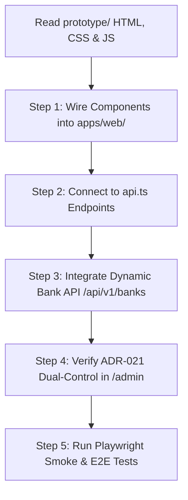

# 12 — UI Redesign Decisions, Gap Resolutions & Next Agent Handoff

**Product**: BFSI — Intelligent Risk, Fraud & Financial Experiences  
**Working Name**: TrustPay SEA  
**Doc Version**: 1.0 · **Date**: 2026-10-15  
**Context**: Handover notes detailing the UI/UX overhaul decisions, gap resolutions, PII redaction policy, and implementation roadmap from the static prototype suite in `prototype/` to the Next.js/FastAPI production codebase.

---

## 1. Executive Summary

During the comprehensive audit of `docs/01` through `11`, several critical product, UX, and security gaps were surfaced (notably around score polarity confusion, the risk of scammer-QA probing, physical QR quishing, and the legal tension of PII disclosure).

To resolve these gaps and solve the fragmented developer-style user experience in `apps/web`, a complete **high-trust BFSI design system** was established and realized as a complete interactive prototype suite in [`prototype/`](../prototype/).

---

## 2. Gap Resolution Matrix

This table records all gaps identified during audit and how they are addressed:

| Gap ID | Identified Problem | Adopted Resolution & UX Decision | Where Recorded / Implemented |
| :--- | :--- | :--- | :--- |
| **NG-2** | **Score Polarity Confusion**: In credit scoring / Truecaller, higher numbers mean safe. In TrustPay, 100 = Critical Fraud. Bare numbers confuse payers. | **Risk Gauge Standard**: Bare numbers are prohibited in public UI. Every score renders as a 4-band gauge (`Low` → `Caution` → `High` → `Critical`) with explicit direction microcopy: *"Risk Score 88/100 · Critical Fraud (Higher score = higher scam likelihood)"* + explainable factor breakdown drawer. | `prototype/check.html`<br>`prototype/receipt.html` |
| **G-1 / ADR-016** | **Money Mule Name Mismatch**: Scammers tell victims *"Pay admin Siti"*, but the destination account belongs to rented mule *"Bambang"*. | **Recipient Name Matcher Radar**: Payer enters what the seller told them. System checks against reported/verified holder name and flashes: *"⚠️ NAME MISMATCH: Seller claimed 'Siti', account belongs to 'Bambang S.' (Mule Alert)"*. | `prototype/check.html`<br>`prototype/index.html` |
| **Asymmetric PII** | **Redaction Parity Fallacy**: Blurring the scammer's bank account or name makes the platform useless (users can't confirm who they are paying). | **Asymmetric Redaction Rule**: Strict fail-closed blurring for **Victim PII** (sender account, real name, balance, private chats), while **Target Destination** details (recipient account, holder name, amount, date) stay **100% CLEAR and UNREDACTED**. | `prototype/check.html`<br>`prototype/report.html`<br>Section 3 of this doc |
| **NG-1** | **Quishing / QR Sticker Swap**: Criminals paste fake QR stickers over legitimate street merchant acrylic stands. | **Merchant QR Self-Check & Payload Drift Alert**: Added alert banner when a scanned QR's NMID or payload differs from previously recorded scans for that merchant. | `prototype/check.html` |
| **NG-3 / Doc 09** | **Scammer QA Probing**: Fraudsters query TrustPay API in batches to check which mule accounts are burned. | **Exact-Match-Only + Probe Anomaly Throttling**: Prohibit bulk search/listings; throttle clients probing multiple distinct unknown accounts sequentially. | API Key Tier Doc 09<br>`prototype/index.html` |
| **Unverified False Safety** | A fresh mule account created 2 hours ago has 0 reports. A green "Safe" badge gives false reassurance. | **Amber "Unverified" Badge**: Unreported accounts render an Amber badge with clear disclaimer: *"Not yet in our registry — does not guarantee safety. Verify seller independently."* | `prototype/check.html` |
| **NG-5** | **OJK / FSTI Perimeter**: Risk scoring platforms approach POJK 30/2025 financial aggregator regulations. | **Statutory Non-Custodial Disclaimers**: UI shell incorporates persistent legal notices: *"Informational reputation registry, not financial advice, holds no consumer funds."* | `prototype/index.html`<br>`apps/web/components/Footer.tsx` |
| **ADR-021** | **Admin Four-Eyes Dual Control**: Destructive actions (hiding reports, approving dispute takedowns, gov overrides) previously lacked UI. | **Dual-Control Approval Queue Workbench**: Analysts can request actions; second senior analyst must review and approve before execution. | `prototype/admin.html` |
| **4B.1** | **Payment Interruption Friction**: Scammers rely on rushed transfers. | **12–15s Cooling-Off Timer Interstitial**: Forces payers to pause, reflect, and acknowledge risk before viewing high/critical entity details. | `prototype/check.html` |
| **4B.4 / 4B.5** | **Victim Distress & Post-Loss Paralysis**: Victims don't know who to call within the critical 0–24h recovery window. | **Emergency Recovery Hub & Bank Fraud Desk**: Direct dials for OJK 157 (ID), NSRC 997 (MY), 1799 (SG), 1441 (TH) + HaloBCA, Mandiri, BRI, CIMB numbers. | `prototype/recovery.html` |

---

## 3. The Asymmetric PII Redaction Standard

### 3.1 The Principle
A registry designed to prevent payment fraud must maintain **asymmetry** between the victim and the scammer:
* **Victim / Reporter Data = Private & Protected**: Victims of fraud are private citizens at risk of doxing, revenge harassment by criminal syndicates, and financial disclosure.
* **Scammer / Destination Entity = Public & Verifiable**: The destination bank account and holder name are the exact payment coordinates that every payer must inspect to avoid being scammed.

### 3.2 Redaction Specification

| Data Element | Field Location | Redaction Policy | Technical Behavior |
| :--- | :--- | :--- | :--- |
| **Victim Sender Account** | Transfer slip / bank statement | **MANDATORY BLUR** | AI Vision automatically masks/crops digits. |
| **Victim Real Name** | Slip sender field / Chat header | **MANDATORY BLUR** | AI Vision applies `censored-blur` or black banner. |
| **Victim Account Balance** | Bottom of mobile banking slip | **MANDATORY BLUR** | Redacted in quarantine before public bucket write. |
| **Victim Chat Avatars** | WhatsApp / Telegram screenshots | **MANDATORY BLUR** | Faces and profile photos blurred. |
| **Scammer Destination Account** | Slip recipient field / check input | **CLEAR / UNREDACTED** | Displayed so payers can verify account numbers match. |
| **Scammer Recipient Name** | Slip recipient / bank holder name | **CLEAR / UNREDACTED** | Disclosed on exact-match lookups with confidence tag (ADR-016). |
| **Transfer Amount & Date** | Slip header | **CLEAR / UNREDACTED** | Kept visible to verify transaction authenticity. |
| **Payment Slip Ref ID** | Slip transaction details | **CLEAR / UNREDACTED** | Needed by banks and police for inter-bank freezes. |

### 3.3 Legal Defense (UU ITE Article 27(3) & PDPA)
* Publishing a general public "hit-list" or scraping directory of names labeled "criminals" violates Indonesian UU ITE and regional defamation laws.
* However, **Contextual Exact-Match Disclosure** (revealing the name only when a user explicitly enters that specific account number or scans the QR) functions as a legitimate **Caller-ID / Destination Verification** utility under fair-use fraud mitigation.

### 3.4 Visual Trust Standard: Institutional Light Mode (Anti-Crypto / Anti-Gambling Aesthetic)
* **Design Decision**: The initial dark-mode developer aesthetic was rejected based on user feedback. Dark backgrounds with glowing neon gradients (`slate-950` with neon emerald/rose orbs) evoke crypto tokens, hacker forums, or online gambling apps — creating suspicion rather than trust.
* **Adopted Aesthetic**: Modeled directly after **CekRekening.id**, **Truecaller**, **Getcontact**, **Singpass/GovTech**, and commercial banking portals (BCA, Mandiri, Maybank, DBS):
  * **Canvas**: Clean, bright white card surfaces (`#FFFFFF`) on soft slate-50 (`#F8FAFC`).
  * **Primary Palette**: Trust Navy / Truecaller Blue (`#1E40AF` / `#2563EB`) communicating authority and institutional calm.
  * **Status Accents**: Soft, legible institutional pastels:
    * Critical Fraud: `bg-red-50 text-red-800 border-red-200`
    * Safe / Verified: `bg-emerald-50 text-emerald-800 border-emerald-200`
    * Caution / Disputed: `bg-amber-50 text-amber-800 border-amber-200`
    * Informational: `bg-blue-50 text-blue-800 border-blue-200`
  * **Typography & Geometry**: Clean system sans typography with clear line heights, rounded-xl containers with subtle borders (`border-slate-200`), and zero neon glow effects.

---

## 4. Prototype Suite Inventory

The complete interactive prototype suite is stored in [`prototype/`](../prototype/). Every page conforms to the **clean, light-mode BFSI standard** (Truecaller / CekRekening.id / commercial bank aesthetic), uses **English by default**, includes a **country language switcher dropdown** (🇺🇸 EN, 🇮🇩 ID, 🇲🇾 MS, 🇹🇭 TH, 🇻🇳 VI, 🇵🇭 FIL), and features the **unified Shield SVG logo**:

1. **`index.html` (Truecaller-Style Hero & Multi-Country Registry Search)**:
   - Truecaller-style hero with smartphone verification mockup and high-trust BFSI visual hierarchy.
   - Interactive search tabs (Bank Account with 393-institution directory, Phone Number, QR / QRIS).
   - Live Recipient Name Matcher input field.
   - Unified SVG logo, English default, and country language dropdown.
2. **`check.html` (The Truecaller + Google Reviews Search Results Dossier)**:
   - 4-scenario interactive switcher: `Confirmed Fraud (88)`, `Dispute Active (42)`, `Clean Merchant (5)`, `New / Unreviewed (15)`.
   - Recipient Name Mismatch Radar alert (ADR-016).
   - Segmented Risk Gauge with polarity clarity microcopy (0–100, where higher score = higher danger).
   - Asymmetric Redaction Evidence Viewer with interactive "Protected (Public)" vs "Unredacted (Analyst)" switch.
   - **Top 10 Reports Pagination**: Dynamic JS rendering of 10 reports per page with page numbers and Prev/Next controls across 24 simulated reports.
   - **Community Review Flagging Modal**: Interactive form allowing users to report false/smear reviews with reason taxonomy.
   - **Account Owner Name-Clearing Portal**: Modal allowing owners to contest false reports, prove legitimate KYC, activate safe-harbor score freeze ($\le 45$), and pin clarification statements.
   - Mandatory Cooling-Off countdown timer.
3. **`report.html` (Empathetic 4-Step Fraud Incident Reporting Flow)**:
   - Step 1: Destination Account & Claimed Seller Name.
   - Step 2: Loss Amount, Currency selector, and Modus category taxonomy.
   - Step 3: Evidence Slip upload with live before/after PII redaction demonstration (Victim PII blurred, scammer destination unredacted).
   - Step 4: Truthfulness statutory anti-perjury declaration & police report reference.
4. **`claim.html` (Merchant Shield & Name-Clearing Dispute Portal)**:
   - Ownership proof via QRIS NMID, m-banking profile, or business license (NIB/SSM/ACRA).
   - Immediate **Safe-Harbor Score Freeze ($\le 45$)** activation.
   - Public counter-statement editor pinned under contested reviews.
5. **`recovery.html` (Emergency Scam Response & Bank Freeze Hub)**:
   - National anti-scam command center direct dials (ID 157, MY 997, SG 1799, TH 1441, VN, PH).
   - Hour 0–24 step-by-step account freeze protocol for BCA, Mandiri, BRI, BNI, Maybank, and DBS.
6. **`admin.html` (Analyst Workbench & Dual-Control Adjudication)**:
   - ADR-021 Four-Eyes Approval queue for `REMOVE_REPORT_DISPUTE` and `HIDE_REPORT`.
   - Slip AI Tamper Inspector (pHash duplicate detection, font clone-stamp flags, OCR entity extractor).
7. **`receipt.html` (Certified Pre-Payment Diligence Slip)**:
   - Print-optimized CSS / PDF export with certificate ID (`#TP-REC-2026-98124`), cryptographic QR code, and query timestamp.

### 4.1 Running and Testing the Prototype
To test the complete prototype locally without Node.js dependencies, run:
```bash
python -m http.server 3000 --directory prototype
```
Then navigate to `http://localhost:3000` in any web browser.

---

## 5. Next Agent Migration & Implementation Roadmap

The next AI agent implementing these designs into the production Next.js codebase (`apps/web/`) should follow this sequential plan:



### Step 1: Component Porting Guide
* Port layout and navigation from `prototype/index.html` to `apps/web/components/Navbar.tsx` and `apps/web/components/Footer.tsx` (already drafted in `apps/web/components/`).
* Extract reusable React components into `apps/web/components/`:
  * `RiskGauge.tsx` (from `check.html`)
  * `NameMatcherBanner.tsx` (from `check.html`)
  * `CoolingOffTimer.tsx` (from `check.html`)
  * `RedactedSlipViewer.tsx` (from `check.html` / `report.html`)
  * `ReportCard.tsx` with upvote/flag handlers (from `check.html`)
  * `EmergencyHotlinesGrid.tsx` (from `recovery.html`)

### Step 2: API Integration Mapping
Connect the components to the existing typed client in `apps/web/lib/api.ts`:
* **Lookup**: Use `screenAccount({ country, bank, account })`, `searchPhone(country, phone)`, and `screenQr(payload)`.
* **Dynamic Banks**: Replace static bank list with `listBanks(country)` from `GET /api/v1/banks`.
* **Name Matcher**: Compare `result.data.entity.holder.name` with user-entered `nameClaim`. If mismatch, render `NameMatcherBanner`.
* **Reporting**: Wire 4-step wizard to `createReport(token, payload)` and `uploadEvidence(token, reportId, file)`.
* **Disputes**: Wire `claim.html` form to `createDispute(token, payload)` and `listDisputes()`.
* **Dual-Control Approvals**: Wire `admin.html` approval buttons to `approveApproval(token, approvalId)`.

### Step 3: Critical Invariants (DO NOT REGRESS)
1. **Never store cleartext account numbers**: All accounts are looked up by KMS HMAC.
2. **Fail-Closed PII Redaction**: If the AI model or provider fails, evidence images remain in quarantine and report stays `PROCESSING`/`FAILED`. Never publish unredacted slips.
3. **Rise-Only Dispute Freeze**: An active dispute caps score increases at $\le 45$; it never lowers confirmed government blacklists or existing high scores.
4. **Four-Eyes Approval**: High-stakes destructive operations (`hide_report`, `remove_report`, `gov_override`) require two distinct analyst credentials.
5. **Exact-Match Name Disclosure**: Holder names are only disclosed on full exact lookups (ADR-016), never in bulk listings.
